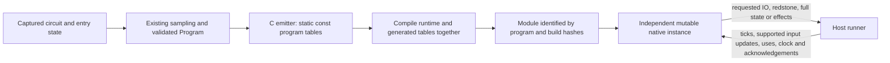

# Circuit-specific LLVM program compilation

Status: implemented and verified, 2026-11-11. Runtime and circuit tables compile together; the normal runner loads a matching program module. Native semantic version 36 adds the idle-start contract below. Results are recorded in [static-program results](test_data/cpu-references/llvm_static_program_results.json) and [idle-start verification](test_data/cpu-references/llvm_idle_start_results.json). Fresh performance comparison is deferred because the CPU is busy; correctness checks pass.

## Goal

Generate C containing the native runtime and the complete validated Redpilator program as `static const` arrays, then compile a native module specifically for that circuit. During execution, the host runner submits tick, input/update and use requests and reads only the requested publications and effects.

"Circuit-specific" means the compiled redstone circuit, such as ZCore12B or PM1. The host machine's architecture and compiler target are separate parts of artifact identity.

The normal LLVM path must satisfy this contract. Embedding tables in a library while continuing to execute against an unrelated host-supplied program blob does not satisfy it.

## Starting implementation and gap (before this change)

- `sampled/llvm/encoding.rs` serializes a validated program into a descriptor and an aligned binary blob.
- `sampled/llvm/cache.rs` compiles the same runtime C sources for every circuit. Its build identity excludes circuit data, and `ModuleState` retains a single module path.
- `sampled/llvm/mod.rs` loads that library, passes the descriptor/blob to native creation, retains the blob, and separately binds command data.
- `engine.c` and `llvm_movement.c` execute the circuit through runtime table pointers. Clang optimizes the executor, but its compilation does not include the circuit tables.
- Tick dispatch already selects the native executor when LLVM is active. The Rust simulation is not also advanced. Minimal IO/redstone publication and sixteen-tick native batches already exist and should be reused.

The change is to the program representation, build identity, module binding and runner boundary. It is not a new circuit sampler or a new redstone model.

## Idle-start contract

Fresh LLVM compilation accepts a stopped circuit between complete ticks, with no scheduled component ticks, piston events, active motions or unfinished movement work. It rejects busy entry without advancing or changing the world. Powered components, memory contents and fully extended stationary pistons remain valid. An empty work queue does not imply electrical equilibrium: dormant reactive components retain their existing behavior.

The generated module fixes scheduler capacity, reactive/lazy-wire decisions and movement dimensions as compilation constants. The scheduler, piston movement and wire history remain fully dynamic after input requests start the circuit. Internal continuation/import tests can generate a module with an explicit imported-tick capacity, included in its identity. Resuming an unchanged prepared executor preserves its live state. The default Rust executor retains its existing entry behavior.

## Required architecture

### Immutable program

Generate compile-time constants for components, sources, output instructions, electrical links, movement groups/ranges/flips/steps, wire routing, shape programs, watcher lists, comparator/note metadata and the remaining auxiliary tables. Include immutable command bytecode, command literals and command notification tables; PM1 must not keep a second host-interpreted command program.

Preserve canonical ordering and IDs from the validated program. Emit explicit integer types, checked lengths and correctly aligned typed data. Handle empty tables without depending on nonstandard zero-length arrays. Do not expose mutable aliases to generated arrays.

The runtime's component, operation, link and auxiliary accessors must resolve to the generated constants. Where a table identity or length is known in the runtime source, LLVM must be able to see its address and size during optimization. Dynamic indices and circuit state remain dynamic.

Compile the generated data and runtime in the same translation unit, or use an equivalently verified arrangement that exposes the data to LLVM optimization. Merely linking opaque binary data from a separate object is insufficient for this goal.

The first implementation does not need to emit a separate C function for every circuit operation or movement transition. That is a later optimization if profiling shows that static tables leave significant dispatch overhead.

### Mutable native state

Keep signal/input accounting, scheduler queues, clocks, piston motion, update stamps, wire history, command success counts, command quotas and queued effects in instance-owned mutable storage. None belongs in shared mutable globals.

Two instances may share one compiled module and its immutable tables while having independent execution state. Initial state templates can be embedded; imported pending work and the instance's logical clock remain initialization requests.

Module instantiation must not require a host-owned copy of the immutable execution blob. Temporary encoder/emitter buffers can be freed after successful loading and initialization. Host metadata needed for publication and interpreter handoff may remain, but must not become a second inference path.

### Runner boundary

| Request | Required behavior |
| --- | --- |
| Create/import | Check module identity and ABI, allocate an independent instance and import supported initial ticks/state. |
| Tick/batch | Advance actual game ticks with the existing scheduler and movement phases; preserve exact completed-prefix reporting. |
| Input update/use | Validate a compiled control identifier and apply the request natively. |
| Clock/capacity/acknowledgement | Supply host time where required, service buffer growth, and acknowledge delivered effects without duplicate execution. |
| IO publication | Read only requested controls and visible outputs. No wire, piston, electrical or pending-queue snapshot. |
| Redstone publication | Read only the necessary packed visual component data. Exclude piston geometry and motion. |
| Full publication/reset/handoff | Explicitly export the complete state required by the existing interpreter handoff. |
| Effects | Transfer only queued command output, note events and necessary acknowledgement/quota data. |

No full-state readback is permitted on each tick or batch. With publication disabled, stepping must not export simulation state. Host buffer management, packet/world publication and read-only projection updates are allowed; host electrical inference and movement replay are not.

Retain native batching and per-tick command-clock semantics. Publishing less frequently must not change logical execution. Do not add the removed `--io-only` or `--update` options.

Supported input updates do not include arbitrary topology edits to an active circuit. Retain the existing edit restrictions and recompilation lifecycle.

## Compilation, cache and module identity

1. Validate the complete program before generating C. Reuse the existing validated representation rather than writing a second lowering pipeline.
2. Derive a deterministic identity from every immutable program section, command tables/literals, captured initial templates, strict/relaxed semantics, emitter version, native ABI/semantic version, runtime sources, compiler/linker identity, flags and target architecture/OS.
3. Build or reuse the artifact for that identity. Replace the single generic-path assumption with lookup by complete build identity. Different circuits with equal component counts must not share an incompatible module.
4. Compile outside the simulation timer, on the existing compilation worker. Propagate cancellation and stale-result rejection through emission, native compilation and loading.
5. Publish a completed artifact atomically. Failed or cancelled builds must not become reusable results or active runtimes.
6. Query and check the loaded module's embedded program identity and ABI before activation. `MCHPRS_LLVM_DLL` must not silently bypass the program-identity check; an explicit module for a different circuit must fail clearly.
7. Retain each loaded module until its last instance is destroyed. Cache clearing invalidates future reuse while preserving active instances, existing ownership checks and deferred removal of locked libraries.

Live input changes, uses, ticks and publication-mode changes do not trigger recompilation. A newly captured initial template may initially produce a different artifact identity; separating templates for broader reuse is not required in the first implementation.

Preserve the existing process-owned cache lifetime. Persistent cross-process caching is not required by this scope. Avoid introducing unbounded parallel native builds.

## Correctness requirements

- Strict mode retains MROWW's existing scheduling priorities, callback order, head/BUD behavior, observer release edges, analog strengths, duplicate contribution accounting and failure semantics.
- Preserve operation limits, work-counter semantics and the exact successful prefix before an error. Constant propagation must not be implemented by moving runtime budget checks past observable operations.
- Preserve command output ordering, quota/acknowledgement behavior, buffer-capacity retries and handoff state.
- Keep the currently validated `--relaxed` behavior as a distinct program identity. This project does not authorize additional correctness relaxations.
- Use the current generic native implementation as a test reference. The completed normal LLVM path must use the generated module and report a compile/load error rather than silently reverting to generic execution or the Rust executor.
- Continue supporting Windows DLL and Linux shared-library builds. Reject unsupported toolchains or invalid generated programs with a useful error; do not run a partially initialized instance.

## Implementation map

Paths below are relative to `crates/core/src/redpilator/` unless stated otherwise.

| Area | Required change |
| --- | --- |
| `sampled/llvm/encoding.rs` and a small emission module if needed | Emit deterministic C constants from validated tables; include identity and typed table metadata. |
| `sampled/llvm/command.rs`, `command_notifications.rs`, `command_engine.c` | Separate immutable command program data from mutable command state and embed the immutable sections. |
| `sampled/llvm/cache.rs` | Compile runtime plus generated data, key artifacts by complete identity, and retain ownership/cancellation/clear semantics. |
| `sampled/llvm/library.rs`, `abi.h` | Load the matching module, query/check identity, and create state against the embedded program. Version incompatible ABI changes. |
| `sampled/llvm/engine.c`, `llvm_movement.c` | Read generated constants directly; keep mutable state and established execution algorithms. |
| `sampled/llvm/mod.rs` | Construct the circuit-specific module and instance; remove the live host-blob dependency and redundant immutable command bindings. |
| `compiler.rs`, `compiler/publication.rs`, `sampled/llvm/publication.rs` | Wire the compile worker and thin execution boundary into existing lifecycle/publication paths. Keep full export explicit. |
| Existing native/cache/publication tests and benchmark examples | Cover generation, identity, instance isolation, parity, minimal ABI reads and fair timing. |
| Root README and `docs/REDPILATOR_ARCHITECTURE.md` | Describe the implemented behavior once it actually changes; retain clear strict/relaxed semantics. |

Do not replace the sampler, Rust backend, native scheduling model or publication protocol as part of the initial change. Avoid introducing another LLVM binding dependency when the existing Clang/LLD build path can perform this compilation.

## Delivery sequence

### 1. Prove emission and optimization visibility

Emit one small program and the existing frozen ZCore program into a scratch build containing the current runtime. Confirm the module uses embedded arrays without accepting a caller-supplied execution blob. Compare disassembly or LLVM IR to verify constant table bases/counts are visible and the hot path does not still depend on mutable host program pointers.

An existing frozen ZCore encoded payload is approximately 100 MiB before textual C emission. Measure emitted size, native compile/link time, compiler peak memory and artifact size before choosing the final representation. Prototype a compact constant initializer or supported compile-time embedding method rather than assuming millions of comma-separated literals are practical. Any compiler-specific embedding feature needs an explicit compatibility check on the supported toolchain.

This is the first engineering checkpoint. Do not expand to all circuits until a large-program build is practical and exact native parity is demonstrated.

### 2. Implement the generated program and ABI

Add deterministic emission, embedded identity and direct static accessors. Cover every immutable section, including command data. Update module creation to use the embedded program and keep initial pending work and mutable execution state separate. Prove two independent instances can use the same module.

### 3. Integrate program-aware builds and the runner

Use the generated module in the normal LLVM compile path. Update cache lookup, explicit-DLL identity checks, cancellation, failed-build handling and lifetime management. Reuse existing minimal publication and native batch entry points. Remove obsolete host bindings where the compiled module now owns their immutable data.

### 4. Validate semantics and measure performance

Run the tests below against matching strict and relaxed references. Then benchmark generated versus generic native execution with the same circuit data and protocol. Diagnose any repeatable regression before declaring the implementation ready.

Architectural compliance and speed are separate acceptance claims: embedding the program is required, and a speed increase must be measured rather than assumed. Further handler generation or data-layout changes require their own evidence.

## Verification and acceptance gates

### Generation, identity and lifecycle

- Identical validated input emits identical program data and identity. A changed link, callback order, command literal or mode changes identity.
- Two programs with identical counts but different contents cannot reuse or load each other's artifacts.
- An explicitly selected wrong-program DLL is rejected before state creation.
- Empty tables, alignment, length/ID overflow and malformed metadata are checked.
- Two instances of one module have independent controls, schedules, motion and effects; interleaved use cannot cause cross-instance state changes.
- Cancellation, failed builds, concurrent reuse and cache clear retain the current ownership and loaded-module guarantees.
- Publication reads do not mutate inference state. IO/redstone/effects paths never request excluded full-state or piston data.

### Engine and fixture parity

| Check | Required comparison |
| --- | --- |
| Existing mechanism tests | Native/Rust parity, short pulses, analog accounting, observers, piston heads, ordering, failure prefixes, reset and effects. |
| Generated versus generic native | Within the same semantic mode, compare full exported state, ordered pending work, game clock and native work count at the established checkpoints, plus focused every-tick traces. |
| ZCore12B | Same Load/413-preparation/Run protocol; all 800 screen lamps match after Run and each of 50,000 game ticks, including the active Sierpinski display. |
| New PM1 baseline | `test_data/pm1_redpilator.schem`, Start only; 12,070 ticks, all 1,792 physical RAM pairs, 1,452 lamps, 1,534 ordered messages and halt state match the pinned interpreter reference. |
| FPU | Existing seeded 10,000-tick output protocol matches the interpreter, including output wire ports. Retain the protocol's limited opcode coverage; do not call it exhaustive arithmetic or clock-edge verification. |
| Publication and handoff | IO/redstone/full switching, low-frequency publication, effect retries/acknowledgements and full reset/handoff preserve state and outputs. |

Keep the previously authorized ConnectFour skip. Do not weaken an assertion to admit generated execution.

### Performance protocol

- Establish a fresh paired baseline against the current generic native runtime, with identical strict/relaxed mode, inputs, tick count, publication settings and compiler flags.
- Time actual game ticks. Compilation, initialization, preparation, output checks and diagnostics remain outside the kernel timer. Verify clock advancement, activity and changing outputs separately.
- Use sequential alternating repetitions on the same timing CPU, with fresh state per sample and no overlapping builds/profilers. Report individual samples, medians, paired gains and timing spread.
- Measure both direct native batches and the real host runner. Separately measure generation, native compile/link, cold/warm load, peak build/runtime memory and artifact size.
- Benchmark without publication first, then with sparse IO/redstone publication. Live-server packet/client costs are a separate measurement, not implied by kernel TPS.
- The latest retained generic relaxed ZCore comparison was about 4,833 TPS median, with a separate host-wrapper sample near 4,932 TPS. These are historical context, not a replacement for the fresh baseline. See `test_data/cpu-references/relaxed_wire_walk_results.json`.

## Completion checklist

- [ ] Every immutable circuit section, including command bytecode/literals, is embedded as compile-time constant data.
- [ ] LLVM compiles that data together with the runtime, and hot accesses resolve to those constants.
- [ ] Artifacts are keyed and checked by complete program/build identity.
- [ ] Native instances own independent mutable state and have no live host execution-blob dependency.
- [ ] The host only manages lifecycle, requests, clock/buffers and requested publication/effects during execution.
- [ ] Strict semantics and existing relaxed behavior pass the mechanism and fixture protocols.
- [ ] Build cost, memory and repeated runtime performance are recorded separately.
- [ ] Normal LLVM execution uses this architecture without silent generic fallback.
- [ ] Current architecture documentation and reproduction commands are updated after implementation.

This document does not claim a completed implementation, a speedup from static embedding, or live-server performance parity.
