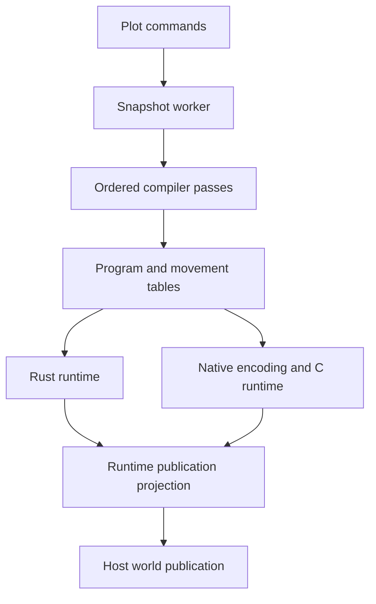

# Redpilator function and type map

This is the production code map for Redpilator and its plot command/compilation integration. It includes Rust functions and methods, Rust structs/enums/traits/type aliases, C function definitions and C structs. Test functions and external OS function declarations are excluded; test locations are listed at the end. Conditional platform implementations are listed separately.

The index contains **590 function definitions** and **132 type declarations** across **48 source files**. Function documentation describes purpose and inputs, with implementation details where they clarify the behavior. Each module lists documented functions first, then its remaining functions and methods.

## Start here

1. Player commands enter [handle_redpilator_command](../crates/core/src/plot/commands/redpilator.rs). The plot [captures a snapshot and launches a worker](../crates/core/src/plot/redpilator_compilation/mod.rs).
2. The public [Compiler](../crates/core/src/redpilator/compiler.rs) checks admission/cache state and calls the [ordered sampled passes](../crates/core/src/redpilator/sampled/compiler.rs).
3. Passes fill [Program](../crates/core/src/redpilator/sampled/program.rs). [Movement lowering](../crates/core/src/redpilator/sampled/movement.rs) owns movement tables and their validation; [piston capture](../crates/core/src/redpilator/sampled/pistons.rs) owns physical actor/payload records.
4. The [Rust executor](../crates/core/src/redpilator/sampled/executor.rs) creates mutable state and runs inputs/ticks. The optional [native runtime](../crates/core/src/redpilator/sampled/llvm/mod.rs) executes the same program contract through checked tables.
5. [Runtime projection](../crates/core/src/redpilator/sampled/publication.rs) describes current blocks/animations. [Compiler publication](../crates/core/src/redpilator/compiler/publication.rs) writes them into the host world and reconciles motion identities. Reset exports pending work back to the interpreter.

## Ownership rules

- General program construction, record validation and indexes belong to `sampled/program.rs`. Creating mutable execution arrays belongs to `sampled/executor.rs`.
- Movement records, arrangement lowering and movement validation belong to `sampled/movement.rs`. Sampling interpreter callbacks belongs to the compiler passes; advancing physical motion belongs to the executor.
- Pending tick import/export belongs with the timing ring in `sampled/scheduler.rs`. Diagnostic reporting belongs to `sampled/diagnostics.rs`.
- Runtime projection describes simulation state; compiler publication mutates the host world. These are separate responsibilities with one owner each.
- Rust data, native encoding and C execution are representations of the same behavior at different boundaries. Keep the translation in `sampled/llvm/*`; keep ABI validation at both sides of that boundary.

An **actor** is a piston base. A **token** is a block that pistons can move. An **arrangement** is a combination of token positions. An **axis** describes one token's choices; its **stride** says how much that token's choice changes the combined arrangement index. A **flip** adds/removes an electrical connection during departure or arrival. Component IDs, input-slot IDs, projection-cell IDs and token IDs index different arrays.

## Module ownership

| Source | Responsibility |
| --- | --- |
| [../plot/commands/redpilator.rs](../crates/core/src/plot/commands/redpilator.rs) | Player command parsing/dispatch and protocol-correct completion suggestions. |
| [../plot/redpilator_compilation/mod.rs](../crates/core/src/plot/redpilator_compilation/mod.rs) | Snapshot workers, budgets, stale-result checks, prepared caches and activation into a live plot. |
| [compiler.rs](../crates/core/src/redpilator/compiler.rs) | Public compiler lifecycle: entry checks, cache restoration, backend setup, controls and reset handoff. |
| [compiler/publication.rs](../crates/core/src/redpilator/compiler/publication.rs) | Host-world publication: visibility selection, output flushing and stable piston-motion identity reconciliation. |
| [memory.rs](../crates/core/src/redpilator/memory.rs) | Fallible native-buffer allocation and capacity checks. |
| [mod.rs](../crates/core/src/redpilator/mod.rs) | Public exports and process-wide native-cache entry points. |
| [options.rs](../crates/core/src/redpilator/options.rs) | Compilation flags and publication-mode parsing. |
| [scratch.rs](../crates/core/src/redpilator/scratch.rs) | Isolated world capture, electrical discovery, bounded probe jobs and safe restoration. |
| [task_monitor.rs](../crates/core/src/redpilator/task_monitor.rs) | Cancellation, time budgets and player-visible compilation progress. |
| [sampled/commands.rs](../crates/core/src/redpilator/sampled/commands.rs) | The runtime command-block host, command state and message publication. |
| [sampled/compiler.rs](../crates/core/src/redpilator/sampled/compiler.rs) | The ordered compilation pipeline, with optional source-observation reuse. |
| [sampled/diagnostics.rs](../crates/core/src/redpilator/sampled/diagnostics.rs) | Optional memory and routing reports; no simulation behavior. |
| [sampled/executor.rs](../crates/core/src/redpilator/sampled/executor.rs) | Mutable runtime state, initialization, control inputs, instruction execution and component/piston behavior. |
| [sampled/group_probe.rs](../crates/core/src/redpilator/sampled/group_probe.rs) | Reader/source discovery and selection between dense arrangement tables and graph routing. |
| [sampled/input.rs](../crates/core/src/redpilator/sampled/input.rs) | Digital contribution counts and analog strength histograms. |
| [sampled/mod.rs](../crates/core/src/redpilator/sampled/mod.rs) | Sampled subsystem declarations and shared exports. Execution and publication live in their owner modules. |
| [sampled/movement.rs](../crates/core/src/redpilator/sampled/movement.rs) | Movement-table records, lowering, bounds and validation. This owns compile_movement_flips and its helpers. |
| [sampled/passes/arrangements.rs](../crates/core/src/redpilator/sampled/passes/arrangements.rs) | Arrangement discovery and connection of shared movement lowering to optional routing. |
| [sampled/passes/electrical.rs](../crates/core/src/redpilator/sampled/passes/electrical.rs) | Electrical links, ports, wire watchers, comparator overrides and fixed geometry. |
| [sampled/passes/finalize.rs](../crates/core/src/redpilator/sampled/passes/finalize.rs) | General validation and projection-index preparation. |
| [sampled/passes/mod.rs](../crates/core/src/redpilator/sampled/passes/mod.rs) | Shared captured context, inventory, phase reporting and native callback ordering. |
| [sampled/passes/movement.rs](../crates/core/src/redpilator/sampled/passes/movement.rs) | Interpreter probing for payload departures/arrivals and their ordered callbacks. |
| [sampled/passes/parse.rs](../crates/core/src/redpilator/sampled/passes/parse.rs) | Inventory capture and supported-component/entity admission. |
| [sampled/passes/reactive.rs](../crates/core/src/redpilator/sampled/passes/reactive.rs) | Dependencies that reconcile initially unsettled components. |
| [sampled/passes/share_output_programs.rs](../crates/core/src/redpilator/sampled/passes/share_output_programs.rs) | Sharing of identical immutable output instruction ranges. |
| [sampled/passes/source_order.rs](../crates/core/src/redpilator/sampled/passes/source_order.rs) | Source rise/fall ordering, certified callback reuse and interpreter-frame comparisons. |
| [sampled/pistons.rs](../crates/core/src/redpilator/sampled/pistons.rs) | Piston actors, movable payload capture and contact grouping. |
| [sampled/program.rs](../crates/core/src/redpilator/sampled/program.rs) | Immutable circuit records, general validation and projection/electrical indexes. |
| [sampled/publication.rs](../crates/core/src/redpilator/sampled/publication.rs) | Projection of current runtime blocks, dirty-cell changes and moving piston parts. |
| [sampled/routing.rs](../crates/core/src/redpilator/sampled/routing.rs) | Local connectivity sampling, wire graphs and movement-dependent source searches. |
| [sampled/scheduler.rs](../crates/core/src/redpilator/sampled/scheduler.rs) | Bounded timing-ring queues plus host tick import/export. |
| [sampled/shapes.rs](../crates/core/src/redpilator/sampled/shapes.rs) | Sampled wire-shape and observer callbacks caused by geometry changes. |
| [sampled/source_cache.rs](../crates/core/src/redpilator/sampled/source_cache.rs) | Stable dependency certificates, retained callback observations and shared memory reservations. |
| [sampled/llvm/abi.h](../crates/core/src/redpilator/sampled/llvm/abi.h) | Shared native descriptors and exported ABI declarations. |
| [sampled/llvm/cache.rs](../crates/core/src/redpilator/sampled/llvm/cache.rs) | Owned native build artifacts, tool invocation and cache invalidation. |
| [sampled/llvm/command.rs](../crates/core/src/redpilator/sampled/llvm/command.rs) | Command specification encoding, native command-state ownership and effect decoding. |
| [sampled/llvm/command_engine.c](../crates/core/src/redpilator/sampled/llvm/command_engine.c) | Native command validation, state, power/tick handling, chains and queued output. |
| [sampled/llvm/command_notifications.rs](../crates/core/src/redpilator/sampled/llvm/command_notifications.rs) | Native command-output notification tables. |
| [sampled/llvm/effects.rs](../crates/core/src/redpilator/sampled/llvm/effects.rs) | Native metadata for note playback and effect dependencies. |
| [sampled/llvm/encoding.rs](../crates/core/src/redpilator/sampled/llvm/encoding.rs) | Versioned little-endian program encoding and blob validation. |
| [sampled/llvm/engine.c](../crates/core/src/redpilator/sampled/llvm/engine.c) | Native electrical state, instruction dispatch, scheduled ticks and command/effect hooks. |
| [sampled/llvm/library.rs](../crates/core/src/redpilator/sampled/llvm/library.rs) | OS library handles, symbol resolution, ABI validation and native state allocation. |
| [sampled/llvm/llvm_movement.c](../crates/core/src/redpilator/sampled/llvm/llvm_movement.c) | Native movement validation, token/routing changes, piston events, motion and snapshots. |
| [sampled/llvm/mod.rs](../crates/core/src/redpilator/sampled/llvm/mod.rs) | Native runtime ownership, component admission, controls and pending-tick translation. |
| [sampled/llvm/movement.rs](../crates/core/src/redpilator/sampled/llvm/movement.rs) | Native movement-table encoding and checked state projection into Rust. |
| [sampled/llvm/publication.rs](../crates/core/src/redpilator/sampled/llvm/publication.rs) | Checked control/output component and queued-effect transfers without a full runtime snapshot. |
| [sampled/llvm/routing.rs](../crates/core/src/redpilator/sampled/llvm/routing.rs) | Native encoding of wire and reader routing tables. |
| [sampled/llvm/shapes.rs](../crates/core/src/redpilator/sampled/llvm/shapes.rs) | Native encoding of sampled geometry-shape programs. |

## Plot integration

### [../plot/commands/redpilator.rs](../crates/core/src/plot/commands/redpilator.rs)

Player command parsing/dispatch and protocol-correct completion suggestions.

| Function or method | Purpose |
| --- | --- |
| [`complete_redpilator`](../crates/core/src/plot/commands/redpilator.rs#L13) | Build tab-completion suggestions for Redpilator commands. |
| [`Plot::handle_redpilator_command`](../crates/core/src/plot/commands/redpilator.rs#L176) | Handles a command that starts with `/redpilator` or `/rp` |

### [../plot/redpilator_compilation/mod.rs](../crates/core/src/plot/redpilator_compilation/mod.rs)

Snapshot workers, budgets, stale-result checks, prepared caches and activation into a live plot.

Types: [`CompilationJob`](../crates/core/src/plot/redpilator_compilation/mod.rs#L14) (struct), [`CompilationCache`](../crates/core/src/plot/redpilator_compilation/mod.rs#L89) (struct), [`CompilationResult`](../crates/core/src/plot/redpilator_compilation/mod.rs#L108) (struct), [`EntryVersion`](../crates/core/src/plot/redpilator_compilation/mod.rs#L149) (struct).

| Function or method | Purpose |
| --- | --- |
| [`CompilationJob::spawn`](../crates/core/src/plot/redpilator_compilation/mod.rs#L36) | Start compilation in a worker that owns an isolated plot snapshot. |
| [`CompilationResult::compile`](../crates/core/src/plot/redpilator_compilation/mod.rs#L124) | Prepare a compiler result without accessing the live plot. |
| [`compilation_error`](../crates/core/src/plot/redpilator_compilation/mod.rs#L204) | Format a positional compilation failure with its phase and recovery hint. |
| [`Plot::start_redpilator_with_budget`](../crates/core/src/plot/redpilator_compilation/mod.rs#L263) | Capture the plot and launch one background compilation job. |
| [`Plot::poll_redpilator_compilation`](../crates/core/src/plot/redpilator_compilation/mod.rs#L311) | Poll compilation without blocking the plot's normal event loop. |
| [`Plot::activate_redpilator`](../crates/core/src/plot/redpilator_compilation/mod.rs#L364) | Install a worker's validated executor into the live plot. |

Other functions and methods:

- [`CompilationJob::take_timeout_message`](../crates/core/src/plot/redpilator_compilation/mod.rs#L65)
- [`CompilationJob::take_progress_message`](../crates/core/src/plot/redpilator_compilation/mod.rs#L77)
- [`CompilationCache::exported`](../crates/core/src/plot/redpilator_compilation/mod.rs#L98)
- [`EntryVersion::capture`](../crates/core/src/plot/redpilator_compilation/mod.rs#L163)
- [`EntryVersion::command_output`](../crates/core/src/plot/redpilator_compilation/mod.rs#L174)
- [`EntryVersion::matches`](../crates/core/src/plot/redpilator_compilation/mod.rs#L180)
- [`rejected_position`](../crates/core/src/plot/redpilator_compilation/mod.rs#L190)
- [`Plot::clear_redpilator_cache`](../crates/core/src/plot/redpilator_compilation/mod.rs#L226)
- [`Plot::compiling_redpilator`](../crates/core/src/plot/redpilator_compilation/mod.rs#L231)
- [`Plot::cancel_redpilator_compilation`](../crates/core/src/plot/redpilator_compilation/mod.rs#L235)
- [`Plot::start_automatic_redpilator`](../crates/core/src/plot/redpilator_compilation/mod.rs#L241)
- [`Plot::send_redpilator_diagnostic`](../crates/core/src/plot/redpilator_compilation/mod.rs#L401)
- [`Plot::reject_redpilator`](../crates/core/src/plot/redpilator_compilation/mod.rs#L408)

## Compiler API and scratch worlds

### [compiler.rs](../crates/core/src/redpilator/compiler.rs)

Public compiler lifecycle: entry checks, cache restoration, backend setup, controls and reset handoff.

Types: [`CompileError`](../crates/core/src/redpilator/compiler.rs#L17) (enum), [`ExecutionError`](../crates/core/src/redpilator/compiler.rs#L111) (struct), [`CompileStatistics`](../crates/core/src/redpilator/compiler.rs#L129) (struct), [`Compiler`](../crates/core/src/redpilator/compiler.rs#L153) (struct).

| Function or method | Purpose |
| --- | --- |
| [`CompileError::fmt`](../crates/core/src/redpilator/compiler.rs#L28) | Format a compilation rejection for the caller. |
| [`CompileError::recovery_hint`](../crates/core/src/redpilator/compiler.rs#L68) | Choose a useful next action after compilation fails. |
| [`Compiler::resume_cached`](../crates/core/src/redpilator/compiler.rs#L227) | Resume an executor only after its owner verifies the exported world is unchanged. |
| [`Compiler::compile_cached_with_sampling`](../crates/core/src/redpilator/compiler.rs#L285) | Prepare and activate an executor from a captured circuit. |
| [`Compiler::try_suspend`](../crates/core/src/redpilator/compiler.rs#L380) | Export reset state while retaining all topology, execution and publication bookkeeping. |

Other functions and methods:

- [`ExecutionError::fmt`](../crates/core/src/redpilator/compiler.rs#L117)
- [`CompileStatistics::chat_summary_lines`](../crates/core/src/redpilator/compiler.rs#L141)
- [`Compiler::stats`](../crates/core/src/redpilator/compiler.rs#L177)
- [`Compiler::is_active`](../crates/core/src/redpilator/compiler.rs#L181)
- [`Compiler::current_flags`](../crates/core/src/redpilator/compiler.rs#L185)
- [`Compiler::compile`](../crates/core/src/redpilator/compiler.rs#L189)
- [`Compiler::cached_program`](../crates/core/src/redpilator/compiler.rs#L200)
- [`Compiler::refresh_command_output_state`](../crates/core/src/redpilator/compiler.rs#L212)
- [`Compiler::compile_cached`](../crates/core/src/redpilator/compiler.rs#L267)
- [`Compiler::reset`](../crates/core/src/redpilator/compiler.rs#L357)
- [`Compiler::try_reset`](../crates/core/src/redpilator/compiler.rs#L363)
- [`Compiler::export_for_reset`](../crates/core/src/redpilator/compiler.rs#L389)
- [`Compiler::tick`](../crates/core/src/redpilator/compiler.rs#L403)
- [`Compiler::tick_with_world`](../crates/core/src/redpilator/compiler.rs#L410)
- [`Compiler::on_use_block`](../crates/core/src/redpilator/compiler.rs#L414)
- [`Compiler::try_on_use_block`](../crates/core/src/redpilator/compiler.rs#L420)
- [`Compiler::try_set_pressure_plate`](../crates/core/src/redpilator/compiler.rs#L427)
- [`Compiler::accepts_control`](../crates/core/src/redpilator/compiler.rs#L438)
- [`validate_llvm_entry`](../crates/core/src/redpilator/compiler.rs#L444)
- [`prepare_llvm_runtime`](../crates/core/src/redpilator/compiler.rs#L465)

### [compiler/publication.rs](../crates/core/src/redpilator/compiler/publication.rs)

Host-world publication: visibility selection, output flushing and stable piston-motion identity reconciliation.

Types: [`ExportedMotion`](../crates/core/src/redpilator/compiler/publication.rs#L11) (struct).

| Function or method | Purpose |
| --- | --- |
| [`Compiler::set_publication_mode`](../crates/core/src/redpilator/compiler/publication.rs#L20) | Change visible publication without recompiling or advancing execution. |
| [`Compiler::flush_effects`](../crates/core/src/redpilator/compiler/publication.rs#L62) | Publish command output and note effects without publishing block geometry. |
| [`Compiler::publish`](../crates/core/src/redpilator/compiler/publication.rs#L90) | Copy the compiled state into the world at the requested visibility level. |

Other functions and methods:

- [`Compiler::prepare_publication_buffers`](../crates/core/src/redpilator/compiler/publication.rs#L32)
- [`Compiler::flush`](../crates/core/src/redpilator/compiler/publication.rs#L45)
- [`Compiler::try_flush`](../crates/core/src/redpilator/compiler/publication.rs#L51)
- [`Compiler::try_flush_complete`](../crates/core/src/redpilator/compiler/publication.rs#L80)
- [`is_output`](../crates/core/src/redpilator/compiler/publication.rs#L230)

### [memory.rs](../crates/core/src/redpilator/memory.rs)

Fallible native-buffer allocation and capacity checks.

Other functions and methods:

- [`allocation_error`](../crates/core/src/redpilator/memory.rs#L6)
- [`reserve`](../crates/core/src/redpilator/memory.rs#L13)
- [`zeroed`](../crates/core/src/redpilator/memory.rs#L17)

### [mod.rs](../crates/core/src/redpilator/mod.rs)

Public exports and process-wide native-cache entry points.

Other functions and methods:

- [`initialize_llvm_cache`](../crates/core/src/redpilator/mod.rs#L28)
- [`clear_llvm_cache`](../crates/core/src/redpilator/mod.rs#L32)

### [options.rs](../crates/core/src/redpilator/options.rs)

Compilation flags and publication-mode parsing.

Types: [`PublicationMode`](../crates/core/src/redpilator/options.rs#L4) (enum), [`CompilerOptions`](../crates/core/src/redpilator/options.rs#L31) (struct).

| Function or method | Purpose |
| --- | --- |
| [`CompilerOptions::parse`](../crates/core/src/redpilator/options.rs#L58) | Parse compiler flags and reject conflicting publication modes. |

Other functions and methods:

- [`PublicationMode::parse`](../crates/core/src/redpilator/options.rs#L11)
- [`PublicationMode::name`](../crates/core/src/redpilator/options.rs#L20)
- [`CompilerOptions::publication_mode`](../crates/core/src/redpilator/options.rs#L43)

### [scratch.rs](../crates/core/src/redpilator/scratch.rs)

Isolated world capture, electrical discovery, bounded probe jobs and safe restoration.

Types: [`ScratchEntry`](../crates/core/src/redpilator/scratch.rs#L11) (struct), [`ScratchError`](../crates/core/src/redpilator/scratch.rs#L19) (struct), [`ScratchWorld`](../crates/core/src/redpilator/scratch.rs#L26) (struct), [`WireWatcher`](../crates/core/src/redpilator/scratch.rs#L46) (struct), [`WireSource`](../crates/core/src/redpilator/scratch.rs#L55) (struct), [`WirePorts`](../crates/core/src/redpilator/scratch.rs#L65) (struct), [`WireDiscovery`](../crates/core/src/redpilator/scratch.rs#L141) (struct).

| Function or method | Purpose |
| --- | --- |
| [`discover_wire_ports`](../crates/core/src/redpilator/scratch.rs#L76) | One dust vertex, without flattening paths through other dust vertices. |
| [`discover_wire_watchers`](../crates/core/src/redpilator/scratch.rs#L220) | Find wire changes that must notify piston bases or heads. |
| [`discover_wire_sources`](../crates/core/src/redpilator/scratch.rs#L254) | Electrical extraction alone; watcher construction and executable admission are separate. |
| [`discover_wire_sources_inner`](../crates/core/src/redpilator/scratch.rs#L277) | Discover upstream sources and attenuation for each requested wire. |
| [`discover_lamp_sources`](../crates/core/src/redpilator/scratch.rs#L349) | Collect a lamp's weak and one-hop conducted inputs, expanding each dust contact through the shared wire graph. |
| [`discover_signal_contacts`](../crates/core/src/redpilator/scratch.rs#L397) | Discover the electrical contacts powering a signal-reading block. |
| [`discover_piston_sources`](../crates/core/src/redpilator/scratch.rs#L465) | Discover the direct and quasi-connected inputs sampled by a piston. |
| [`discover_piston_contacts`](../crates/core/src/redpilator/scratch.rs#L483) | Discover direct and quasi-connectivity power contacts for a piston. |
| [`ScratchWorld::from_world_monitored`](../crates/core/src/redpilator/scratch.rs#L1195) | Create an isolated, bounded snapshot for interpreter probes. |
| [`ScratchWorld::probe_jobs`](../crates/core/src/redpilator/scratch.rs#L1436) | Run independent probes with bounded reusable scratch snapshots. |
| [`ScratchWorld::revert`](../crates/core/src/redpilator/scratch.rs#L1519) | Restore a scratch probe to its captured baseline. |
| [`ScratchWorld::finish_probe`](../crates/core/src/redpilator/scratch.rs#L1545) | Reject probe reads or effects that leave the captured contract. |

Other functions and methods:

- [`discover_wire_sources_monitored`](../crates/core/src/redpilator/scratch.rs#L258)
- [`discover_lamp_ports`](../crates/core/src/redpilator/scratch.rs#L353)
- [`discover_torch_sources`](../crates/core/src/redpilator/scratch.rs#L357)
- [`discover_torch_ports`](../crates/core/src/redpilator/scratch.rs#L361)
- [`discover_torch_contacts`](../crates/core/src/redpilator/scratch.rs#L365)
- [`wire_contact`](../crates/core/src/redpilator/scratch.rs#L379)
- [`discover_piston_ports`](../crates/core/src/redpilator/scratch.rs#L473)
- [`is_supported_dynamic_source`](../crates/core/src/redpilator/scratch.rs#L554)
- [`source_emits_to`](../crates/core/src/redpilator/scratch.rs#L568)
- [`ScratchWorld::world`](../crates/core/src/redpilator/scratch.rs#L1389)
- [`ScratchWorld::world_mut`](../crates/core/src/redpilator/scratch.rs#L1392)
- [`ScratchWorld::checkpoint`](../crates/core/src/redpilator/scratch.rs#L1396)
- [`ScratchWorld::fork_basis`](../crates/core/src/redpilator/scratch.rs#L1414)
- [`contains`](../crates/core/src/redpilator/scratch.rs#L1592)

### [task_monitor.rs](../crates/core/src/redpilator/task_monitor.rs)

Cancellation, time budgets and player-visible compilation progress.

Types: [`CompileStatus`](../crates/core/src/redpilator/task_monitor.rs#L6) (struct), [`TaskMonitor`](../crates/core/src/redpilator/task_monitor.rs#L16) (struct).

| Function or method | Purpose |
| --- | --- |
| [`TaskMonitor::status`](../crates/core/src/redpilator/task_monitor.rs#L62) | Describe compilation progress for logs and player messages. |

Other functions and methods:

- [`TaskMonitor::with_deadline`](../crates/core/src/redpilator/task_monitor.rs#L24)
- [`TaskMonitor::budget_expired`](../crates/core/src/redpilator/task_monitor.rs#L28)
- [`TaskMonitor::set_phase`](../crates/core/src/redpilator/task_monitor.rs#L32)
- [`TaskMonitor::set_detail`](../crates/core/src/redpilator/task_monitor.rs#L41)
- [`TaskMonitor::set_progress`](../crates/core/src/redpilator/task_monitor.rs#L45)
- [`TaskMonitor::advance_progress`](../crates/core/src/redpilator/task_monitor.rs#L49)
- [`TaskMonitor::set_counts`](../crates/core/src/redpilator/task_monitor.rs#L55)
- [`TaskMonitor::cancel`](../crates/core/src/redpilator/task_monitor.rs#L85)
- [`TaskMonitor::cancelled`](../crates/core/src/redpilator/task_monitor.rs#L89)

## Sampled compilation and execution

### [sampled/commands.rs](../crates/core/src/redpilator/sampled/commands.rs)

The runtime command-block host, command state and message publication.

| Function or method | Purpose |
| --- | --- |
| [`Runtime::notify`](../crates/core/src/redpilator/sampled/commands.rs#L74) | Deliver native-style neighbor updates after command-block output changes. |
| [`Runtime::publish_commands`](../crates/core/src/redpilator/sampled/commands.rs#L124) | Transfer compiled command state and queued messages to the host world. |

Other functions and methods:

- [`Runtime::block`](../crates/core/src/redpilator/sampled/commands.rs#L8)
- [`Runtime::entity`](../crates/core/src/redpilator/sampled/commands.rs#L12)
- [`Runtime::entity_mut`](../crates/core/src/redpilator/sampled/commands.rs#L16)
- [`Runtime::create_entity`](../crates/core/src/redpilator/sampled/commands.rs#L20)
- [`Runtime::powered`](../crates/core/src/redpilator/sampled/commands.rs#L24)
- [`Runtime::pending`](../crates/core/src/redpilator/sampled/commands.rs#L31)
- [`Runtime::schedule`](../crates/core/src/redpilator/sampled/commands.rs#L38)
- [`Runtime::logical_tick`](../crates/core/src/redpilator/sampled/commands.rs#L50)
- [`Runtime::execute`](../crates/core/src/redpilator/sampled/commands.rs#L54)
- [`Runtime::refresh_command_output_state`](../crates/core/src/redpilator/sampled/commands.rs#L108)
- [`Runtime::queued_command_outputs`](../crates/core/src/redpilator/sampled/commands.rs#L114)

### [sampled/compiler.rs](../crates/core/src/redpilator/sampled/compiler.rs)

The ordered compilation pipeline, with optional source-observation reuse.

| Function or method | Purpose |
| --- | --- |
| [`compile_monitored`](../crates/core/src/redpilator/sampled/compiler.rs#L15) | Build a sampled program from a world snapshot, checking for cancellation between stages. |
| [`compile_monitored_with_source_cache`](../crates/core/src/redpilator/sampled/compiler.rs#L30) | Compile a world snapshot into an indexed redstone program. |

Other functions and methods:

- [`compile`](../crates/core/src/redpilator/sampled/compiler.rs#L10)

### [sampled/diagnostics.rs](../crates/core/src/redpilator/sampled/diagnostics.rs)

Optional memory and routing reports; no simulation behavior.

| Function or method | Purpose |
| --- | --- |
| [`Runtime::log_memory_layout`](../crates/core/src/redpilator/sampled/diagnostics.rs#L11) | Report retained program, runtime and native-encoding storage. |

Other functions and methods:

- [`Runtime::log_memory_layout::vector`](../crates/core/src/redpilator/sampled/diagnostics.rs#L12)
- [`Runtime::log_memory_layout::rows`](../crates/core/src/redpilator/sampled/diagnostics.rs#L21)
- [`Runtime::log_memory_layout::small_rows`](../crates/core/src/redpilator/sampled/diagnostics.rs#L30)
- [`Runtime::log_routing_metrics`](../crates/core/src/redpilator/sampled/diagnostics.rs#L213)

### [sampled/executor.rs](../crates/core/src/redpilator/sampled/executor.rs)

Mutable runtime state, initialization, control inputs, instruction execution and component/piston behavior.

Types: [`PistonEvent`](../crates/core/src/redpilator/sampled/executor.rs#L29) (enum), [`Motion`](../crates/core/src/redpilator/sampled/executor.rs#L42) (struct), [`Runtime`](../crates/core/src/redpilator/sampled/executor.rs#L63) (struct).

| Function or method | Purpose |
| --- | --- |
| [`Runtime::tick`](../crates/core/src/redpilator/sampled/executor.rs#L213) | Run scheduled updates, then piston events and movement, for one game tick. |
| [`Runtime::set_input`](../crates/core/src/redpilator/sampled/executor.rs#L288) | Apply an input slot from `program.sources`; the slot maps to a component ID. |
| [`Runtime::notify_source_watchers`](../crates/core/src/redpilator/sampled/executor.rs#L369) | Deliver the recorded callbacks for a component output change. |
| [`Runtime::notify_home_watchers`](../crates/core/src/redpilator/sampled/executor.rs#L402) | Notify components watching a piston's home cell. |
| [`Runtime::notify_shape`](../crates/core/src/redpilator/sampled/executor.rs#L422) | Replay the shape changes caused by changing one projected cell. |
| [`Runtime::insert_motion`](../crates/core/src/redpilator/sampled/executor.rs#L532) | Allocate or reuse a runtime motion slot. |
| [`Runtime::update_piston`](../crates/core/src/redpilator/sampled/executor.rs#L574) | Decide whether a piston should queue an extension or retraction. |
| [`Runtime::run_piston_events`](../crates/core/src/redpilator/sampled/executor.rs#L624) | Execute queued piston actions in their original order. |
| [`Runtime::finish_piston_part`](../crates/core/src/redpilator/sampled/executor.rs#L806) | Complete the piston-head or base portion of a motion. |
| [`Runtime::tick_motions`](../crates/core/src/redpilator/sampled/executor.rs#L844) | Advance active piston motions and complete due landings. |
| [`Runtime::routed_values`](../crates/core/src/redpilator/sampled/executor.rs#L979) | Compute conditional input attenuation for the current geometry. |
| [`Runtime::refresh_routing`](../crates/core/src/redpilator/sampled/executor.rs#L1035) | Apply connectivity changes after a token moves. |
| [`Runtime::set_token_pos`](../crates/core/src/redpilator/sampled/executor.rs#L1104) | Move a payload and update the circuit connections it changes. |
| [`Runtime::run_move_steps`](../crates/core/src/redpilator/sampled/executor.rs#L1150) | Replay the sampled callbacks for a token leaving or entering a cell. |
| [`Runtime::refresh_wire_power`](../crates/core/src/redpilator/sampled/executor.rs#L1308) | Change a wire's stored strength and dependent signals. |
| [`Runtime::token_dependency_signature`](../crates/core/src/redpilator/sampled/executor.rs#L1362) | Describe a receiver's conditional sources for a proposed token position. |
| [`Runtime::output`](../crates/core/src/redpilator/sampled/executor.rs#L1432) | Read a component's current redstone output strength. |
| [`Runtime::dispatch_receiver`](../crates/core/src/redpilator/sampled/executor.rs#L1500) | Deliver one callback to the correct kind of receiver. |
| [`Runtime::update_note_block`](../crates/core/src/redpilator/sampled/executor.rs#L1551) | Update a note block and queue a note on a valid rising edge. |
| [`Runtime::update_copper_bulb`](../crates/core/src/redpilator/sampled/executor.rs#L1582) | Toggle a copper bulb only on a rising input edge. |
| [`Runtime::update_once`](../crates/core/src/redpilator/sampled/executor.rs#L1608) | Deliver a receiver update at most once for its current effective state. |
| [`Runtime::update`](../crates/core/src/redpilator/sampled/executor.rs#L1637) | Apply an ordinary receiver callback and count its work. |
| [`Runtime::check_watched_wire`](../crates/core/src/redpilator/sampled/executor.rs#L1665) | Notify wire watchers when their observed signal level changes. |
| [`Runtime::update_wire_watcher`](../crates/core/src/redpilator/sampled/executor.rs#L1695) | Update a wire and the watchers associated with that component. |
| [`Runtime::execute_output_program`](../crates/core/src/redpilator/sampled/executor.rs#L1722) | Execute the stored instruction sequence for an output edge. |
| [`Runtime::comparator_result`](../crates/core/src/redpilator/sampled/executor.rs#L1846) | Compute the comparator's next strength and powered flag. |
| [`Runtime::update_comparator`](../crates/core/src/redpilator/sampled/executor.rs#L1882) | Schedule a comparator tick when its desired result changes. |
| [`Runtime::tick_comparator`](../crates/core/src/redpilator/sampled/executor.rs#L1907) | Apply a scheduled comparator output change. |
| [`Runtime::update_reactive`](../crates/core/src/redpilator/sampled/executor.rs#L1939) | Reconcile initially unsettled components affected by a source. |
| [`Runtime::update_torch`](../crates/core/src/redpilator/sampled/executor.rs#L1980) | Schedule a torch transition when its input disagrees with its lit state. |
| [`Runtime::tick_torch`](../crates/core/src/redpilator/sampled/executor.rs#L2002) | Apply a scheduled redstone-torch transition. |
| [`Runtime::update_repeater`](../crates/core/src/redpilator/sampled/executor.rs#L2026) | Refresh repeater locking and schedule an output transition. |
| [`Runtime::drain_ticks`](../crates/core/src/redpilator/sampled/executor.rs#L2117) | Execute every scheduled callback due in the current half-tick. |
| [`Runtime::tick_repeater`](../crates/core/src/redpilator/sampled/executor.rs#L2177) | Apply a scheduled repeater edge while preserving short pulses. |
| [`Program::runtime_from_prepared`](../crates/core/src/redpilator/sampled/executor.rs#L2259) | Create mutable execution state for an already indexed program. |

Other functions and methods:

- [`PistonEvent::bit`](../crates/core/src/redpilator/sampled/executor.rs#L36)
- [`compare`](../crates/core/src/redpilator/sampled/executor.rs#L191)
- [`Runtime::component_count`](../crates/core/src/redpilator/sampled/executor.rs#L244)
- [`Runtime::accepts_control`](../crates/core/src/redpilator/sampled/executor.rs#L248)
- [`Runtime::use_control`](../crates/core/src/redpilator/sampled/executor.rs#L252)
- [`Runtime::set_pressure_plate`](../crates/core/src/redpilator/sampled/executor.rs#L269)
- [`Runtime::mark_dirty`](../crates/core/src/redpilator/sampled/executor.rs#L342)
- [`Runtime::set_component`](../crates/core/src/redpilator/sampled/executor.rs#L349)
- [`Runtime::mark_piston_dirty`](../crates/core/src/redpilator/sampled/executor.rs#L358)
- [`Runtime::queue_piston_extension`](../crates/core/src/redpilator/sampled/executor.rs#L483)
- [`Runtime::pushing_motion`](../crates/core/src/redpilator/sampled/executor.rs#L490)
- [`Runtime::is_early_retract`](../crates/core/src/redpilator/sampled/executor.rs#L496)
- [`Runtime::add_motion`](../crates/core/src/redpilator/sampled/executor.rs#L505)
- [`Runtime::finish_token_part`](../crates/core/src/redpilator/sampled/executor.rs#L789)
- [`Runtime::consume_operation`](../crates/core/src/redpilator/sampled/executor.rs#L883)
- [`Runtime::consume_component_operation`](../crates/core/src/redpilator/sampled/executor.rs#L887)
- [`Runtime::consume_operation_with`](../crates/core/src/redpilator/sampled/executor.rs#L891)
- [`Runtime::input_strength`](../crates/core/src/redpilator/sampled/executor.rs#L906)
- [`Runtime::has_input`](../crates/core/src/redpilator/sampled/executor.rs#L927)
- [`Runtime::set_contribution`](../crates/core/src/redpilator/sampled/executor.rs#L931)
- [`Runtime::set_arrangement_contribution`](../crates/core/src/redpilator/sampled/executor.rs#L939)
- [`Runtime::update_side_inputs`](../crates/core/src/redpilator/sampled/executor.rs#L948)
- [`Runtime::arrangement_contribution`](../crates/core/src/redpilator/sampled/executor.rs#L962)
- [`Runtime::initialize_routing`](../crates/core/src/redpilator/sampled/executor.rs#L1017)
- [`Runtime::arrangement_output`](../crates/core/src/redpilator/sampled/executor.rs#L1085)
- [`Runtime::mark_changed_wire`](../crates/core/src/redpilator/sampled/executor.rs#L1289)
- [`Runtime::begin_phase`](../crates/core/src/redpilator/sampled/executor.rs#L1489)
- [`Runtime::update_hopper`](../crates/core/src/redpilator/sampled/executor.rs#L1520)
- [`Runtime::update_trapdoor`](../crates/core/src/redpilator/sampled/executor.rs#L1531)
- [`Runtime::side_strength`](../crates/core/src/redpilator/sampled/executor.rs#L1836)
- [`Runtime::dispatch_receiver_tick`](../crates/core/src/redpilator/sampled/executor.rs#L2212)
- [`start_runtime`](../crates/core/src/redpilator/sampled/executor.rs#L2220)
- [`start_shared_runtime`](../crates/core/src/redpilator/sampled/executor.rs#L2228)
- [`Program::start`](../crates/core/src/redpilator/sampled/executor.rs#L2240)
- [`Program::into_runtime`](../crates/core/src/redpilator/sampled/executor.rs#L2244)
- [`Program::into_runtime_prepared`](../crates/core/src/redpilator/sampled/executor.rs#L2249)
- [`Runtime::shared_program`](../crates/core/src/redpilator/sampled/executor.rs#L2478)
- [`Runtime::has_motions`](../crates/core/src/redpilator/sampled/executor.rs#L2481)
- [`Runtime::piston_state`](../crates/core/src/redpilator/sampled/executor.rs#L2485)
- [`Runtime::motion_time`](../crates/core/src/redpilator/sampled/executor.rs#L2489)
- [`Runtime::pending_piston_events`](../crates/core/src/redpilator/sampled/executor.rs#L2493)
- [`Runtime::owns_piston`](../crates/core/src/redpilator/sampled/executor.rs#L2497)
- [`Runtime::logical_tick`](../crates/core/src/redpilator/sampled/executor.rs#L2504)
- [`Runtime::pending_piston_event_iter`](../crates/core/src/redpilator/sampled/executor.rs#L2508)

### [sampled/group_probe.rs](../crates/core/src/redpilator/sampled/group_probe.rs)

Reader/source discovery and bounded dense-table admission by estimated visits saved per byte. Shared mappings remain intact until the first byte-budget overflow triggers equivalent-axis digit folding of retained/current/future candidates and rank rebuilding. The estimate assumes uniform token movement; accepted tables retain reader discovery order.

Types: [`InputKey`](../crates/core/src/redpilator/sampled/group_probe.rs#L9) (type), [`InputValue`](../crates/core/src/redpilator/sampled/group_probe.rs#L10) (type), [`Inputs`](../crates/core/src/redpilator/sampled/group_probe.rs#L11) (type), [`ReaderKind`](../crates/core/src/redpilator/sampled/group_probe.rs#L23) (enum), [`ProbeIndexes`](../crates/core/src/redpilator/sampled/group_probe.rs#L43) (struct), [`Discovery`](../crates/core/src/redpilator/sampled/group_probe.rs#L336) (struct), [`DenseRank`](../crates/core/src/redpilator/sampled/group_probe.rs#L387) (struct).

| Function or method | Purpose |
| --- | --- |
| [`find_changed_links`](../crates/core/src/redpilator/sampled/group_probe.rs#L14) | Return keys whose values were added, removed, or changed, in sorted order. |
| [`<'a> ProbeIndexes<'a>::new`](../crates/core/src/redpilator/sampled/group_probe.rs#L93) | Index component positions and movement-sensitive notification routes. |
| [`wire_sources`](../crates/core/src/redpilator/sampled/group_probe.rs#L137) | Resolve either direct wire contacts or their upstream sources. |
| [`discover_inputs`](../crates/core/src/redpilator/sampled/group_probe.rs#L190) | Discover the main and side sources feeding a component. |
| [`electrical_states`](../crates/core/src/redpilator/sampled/group_probe.rs#L299) | Fold token positions that are electrically equivalent for one reader. |
| [`compact_arrangement`](../crates/core/src/redpilator/sampled/group_probe.rs#L342) | Fold equivalent axis digits across all other-axis combinations, retaining token axes and physical digit mappings. |
| [`compact_selected`](../crates/core/src/redpilator/sampled/group_probe.rs#L440) | Compact retained candidates on first budget overflow, rebuild their byte estimates/ranks and return removed row count. |
| [`admit_dense`](../crates/core/src/redpilator/sampled/group_probe.rs#L412) | Replace lower-benefit retained tables while keeping estimated bytes within the budget. |
| [`dense_table_bytes`](../crates/core/src/redpilator/sampled/group_probe.rs#L464) | Estimate retained memory for a dense arrangement table. |
| [`run_with_dense_budget`](../crates/core/src/redpilator/sampled/group_probe.rs#L571) | Choose dense arrangement tables or routing for movement-dependent readers. |

Other functions and methods:

- [`reader_kind`](../crates/core/src/redpilator/sampled/group_probe.rs#L31)
- [`<'a> ProbeIndexes<'a>::notification`](../crates/core/src/redpilator/sampled/group_probe.rs#L54)
- [`<'a> ProbeIndexes<'a>::notifications_at`](../crates/core/src/redpilator/sampled/group_probe.rs#L65)
- [`<'a> ProbeIndexes<'a>::source_at`](../crates/core/src/redpilator/sampled/group_probe.rs#L75)
- [`near`](../crates/core/src/redpilator/sampled/group_probe.rs#L160)
- [`inputs_of`](../crates/core/src/redpilator/sampled/group_probe.rs#L164)
- [`ports_of`](../crates/core/src/redpilator/sampled/group_probe.rs#L174)
- [`placements`](../crates/core/src/redpilator/sampled/group_probe.rs#L322)
- [`DenseRank::cmp`](../crates/core/src/redpilator/sampled/group_probe.rs#L395)
- [`DenseRank::partial_cmp`](../crates/core/src/redpilator/sampled/group_probe.rs#L407)
- [`run`](../crates/core/src/redpilator/sampled/group_probe.rs#L552)

### [sampled/input.rs](../crates/core/src/redpilator/sampled/input.rs)

Digital contribution counts and analog strength histograms.

Types: [`InputState`](../crates/core/src/redpilator/sampled/input.rs#L2) (struct), [`Histogram`](../crates/core/src/redpilator/sampled/input.rs#L16) (struct).

| Function or method | Purpose |
| --- | --- |
| [`InputState::change`](../crates/core/src/redpilator/sampled/input.rs#L29) | Replace one contribution and update the active count and analog histogram. Strength zero represents an absent contribution. |
| [`InputState::maximum`](../crates/core/src/redpilator/sampled/input.rs#L59) | Return the strongest contribution, or 15 for any active digital input. |

Other functions and methods:

- [`InputState::default`](../crates/core/src/redpilator/sampled/input.rs#L10)

### [sampled/mod.rs](../crates/core/src/redpilator/sampled/mod.rs)

Sampled subsystem declarations and shared exports. Execution and publication live in their owner modules.

This file declares types or module exports; it has no production function definitions.

### [sampled/movement.rs](../crates/core/src/redpilator/sampled/movement.rs)

Movement-table records, lowering, bounds and validation. Stable hash indexes accelerate group/condition lookup without changing vector emission order; completed movement buffers release spare capacity. This owns compile_movement_flips and its helpers.

Types: [`MoveStepSpec`](../crates/core/src/redpilator/sampled/movement.rs#L11) (struct), [`MoveStep`](../crates/core/src/redpilator/sampled/movement.rs#L23) (struct), [`ArrangementFlip`](../crates/core/src/redpilator/sampled/movement.rs#L35) (struct), [`MovementAxis`](../crates/core/src/redpilator/sampled/movement.rs#L51) (struct), [`MovementTransition`](../crates/core/src/redpilator/sampled/movement.rs#L64) (struct), [`MovementGroup`](../crates/core/src/redpilator/sampled/movement.rs#L73) (struct).

| Function or method | Purpose |
| --- | --- |
| [`Program::compile_movement_flips`](../crates/core/src/redpilator/sampled/movement.rs#L105) | Build the power changes caused by moving piston-carried blocks. |
| [`Program::movement_group`](../crates/core/src/redpilator/sampled/movement.rs#L327) | Lower one set of token arrangements into movement axes and links. |
| [`Program::set_move_steps`](../crates/core/src/redpilator/sampled/movement.rs#L423) | Store sampled movement callbacks in flat runtime tables. |
| [`Program::validate_movement`](../crates/core/src/redpilator/sampled/movement.rs#L455) | Check that compiled movement groups, links and transitions agree. |
| [`Program::validate_move_steps`](../crates/core/src/redpilator/sampled/movement.rs#L558) | Check sampled movement callbacks against the program's components. |

Other functions and methods:

- [`valid_states`](../crates/core/src/redpilator/sampled/movement.rs#L80)

### [sampled/passes/arrangements.rs](../crates/core/src/redpilator/sampled/passes/arrangements.rs)

Arrangement discovery and connection of shared movement lowering to optional routing.

| Function or method | Purpose |
| --- | --- |
| [`run`](../crates/core/src/redpilator/sampled/passes/arrangements.rs#L12) | Compile the movement-dependent input arrangements. |

### [sampled/passes/electrical.rs](../crates/core/src/redpilator/sampled/passes/electrical.rs)

Electrical links, ports, wire watchers, comparator overrides and fixed geometry.

Types: [`ElectricalCircuit`](../crates/core/src/redpilator/sampled/passes/electrical.rs#L12) (struct).

| Function or method | Purpose |
| --- | --- |
| [`run`](../crates/core/src/redpilator/sampled/passes/electrical.rs#L23) | Build the initial program and its electrical dependency records. |

Other functions and methods:

- [`discover_repeater_rear_sources`](../crates/core/src/redpilator/sampled/passes/electrical.rs#L295)
- [`append_wire_sources`](../crates/core/src/redpilator/sampled/passes/electrical.rs#L339)

### [sampled/passes/finalize.rs](../crates/core/src/redpilator/sampled/passes/finalize.rs)

General validation and projection-index preparation.

| Function or method | Purpose |
| --- | --- |
| [`run`](../crates/core/src/redpilator/sampled/passes/finalize.rs#L12) | Validate the discovered program and prepare runtime projection indexes. |

### [sampled/passes/mod.rs](../crates/core/src/redpilator/sampled/passes/mod.rs)

Shared captured context, inventory, phase reporting and native callback ordering.

Types: [`Context`](../crates/core/src/redpilator/sampled/passes/mod.rs#L23) (struct), [`Inventory`](../crates/core/src/redpilator/sampled/passes/mod.rs#L34) (struct), [`CompilePhases`](../crates/core/src/redpilator/sampled/passes/mod.rs#L57) (struct).

| Function or method | Purpose |
| --- | --- |
| [`update_footprint`](../crates/core/src/redpilator/sampled/passes/mod.rs#L146) | Return notification targets in the order used by the native redstone updates. |

Other functions and methods:

- [`<'a> CompilePhases<'a>::new`](../crates/core/src/redpilator/sampled/passes/mod.rs#L72)
- [`<'a> CompilePhases<'a>::next`](../crates/core/src/redpilator/sampled/passes/mod.rs#L87)
- [`<'a> CompilePhases<'a>::detail`](../crates/core/src/redpilator/sampled/passes/mod.rs#L99)
- [`CompilePhases<'_>::drop`](../crates/core/src/redpilator/sampled/passes/mod.rs#L108)
- [`check_cancelled`](../crates/core/src/redpilator/sampled/passes/mod.rs#L124)
- [`update_order`](../crates/core/src/redpilator/sampled/passes/mod.rs#L135)

### [sampled/passes/movement.rs](../crates/core/src/redpilator/sampled/passes/movement.rs)

Interpreter probing for payload departures/arrivals and their ordered callbacks.

| Function or method | Purpose |
| --- | --- |
| [`run`](../crates/core/src/redpilator/sampled/passes/movement.rs#L14) | Sample the ordered callbacks produced by payload departures and arrivals. |

### [sampled/passes/parse.rs](../crates/core/src/redpilator/sampled/passes/parse.rs)

Inventory capture and supported-component/entity admission.

Types: [`ParsedCircuit`](../crates/core/src/redpilator/sampled/passes/parse.rs#L15) (struct).

| Function or method | Purpose |
| --- | --- |
| [`run`](../crates/core/src/redpilator/sampled/passes/parse.rs#L26) | Capture and validate the circuit inventory before dependency discovery. |

Other functions and methods:

- [`validate_block_entity`](../crates/core/src/redpilator/sampled/passes/parse.rs#L164)

### [sampled/passes/reactive.rs](../crates/core/src/redpilator/sampled/passes/reactive.rs)

Dependencies that reconcile initially unsettled components.

| Function or method | Purpose |
| --- | --- |
| [`run`](../crates/core/src/redpilator/sampled/passes/reactive.rs#L13) | Record the updates needed by initially unsettled components. |
| [`within_two`](../crates/core/src/redpilator/sampled/passes/reactive.rs#L169) | Collect unique cells reached by one or two neighbor updates, in update order. |

### [sampled/passes/share_output_programs.rs](../crates/core/src/redpilator/sampled/passes/share_output_programs.rs)

Sharing of identical immutable output instruction ranges.

Other functions and methods:

- [`run`](../crates/core/src/redpilator/sampled/passes/share_output_programs.rs#L5)

### [sampled/passes/source_order.rs](../crates/core/src/redpilator/sampled/passes/source_order.rs)

Source rise/fall ordering, certified callback reuse and interpreter-frame comparisons.

Types: [`SourceSamplingMetrics`](../crates/core/src/redpilator/sampled/passes/source_order.rs#L18) (struct), [`Frame`](../crates/core/src/redpilator/sampled/passes/source_order.rs#L138) (struct), [`ProbeJob`](../crates/core/src/redpilator/sampled/passes/source_order.rs#L148) (struct), [`ProbeResult`](../crates/core/src/redpilator/sampled/passes/source_order.rs#L155) (struct), [`SourceProbeSignature`](../crates/core/src/redpilator/sampled/passes/source_order.rs#L168) (struct), [`SourceTargetSignature`](../crates/core/src/redpilator/sampled/passes/source_order.rs#L176) (struct), [`OperationSignature`](../crates/core/src/redpilator/sampled/passes/source_order.rs#L184) (enum), [`ArrangementLinkSignature`](../crates/core/src/redpilator/sampled/passes/source_order.rs#L193) (struct), [`ArrangementGroupSignature`](../crates/core/src/redpilator/sampled/passes/source_order.rs#L204) (struct), [`ArrangementSourceSignature`](../crates/core/src/redpilator/sampled/passes/source_order.rs#L215) (enum), [`TokenSignature`](../crates/core/src/redpilator/sampled/passes/source_order.rs#L221) (struct), [`SourceTarget`](../crates/core/src/redpilator/sampled/passes/source_order.rs#L953) (struct), [`SourceIndex`](../crates/core/src/redpilator/sampled/passes/source_order.rs#L962) (struct).

| Function or method | Purpose |
| --- | --- |
| [`SourceSamplingMetrics::drop`](../crates/core/src/redpilator/sampled/passes/source_order.rs#L101) | Print the final source-sampling timing and work counters when enabled. |
| [`source_probe_signature`](../crates/core/src/redpilator/sampled/passes/source_order.rs#L233) | Fingerprint the dependencies used by a source-order probe. |
| [`operation_signature`](../crates/core/src/redpilator/sampled/passes/source_order.rs#L263) | Describe an instruction using stable world identities. |
| [`arrangement_group_signature`](../crates/core/src/redpilator/sampled/passes/source_order.rs#L342) | Describe a conditional-input group independently of runtime IDs. |
| [`lower_edge`](../crates/core/src/redpilator/sampled/passes/source_order.rs#L375) | Translate cached callback observations into the current program's instructions. |
| [`run`](../crates/core/src/redpilator/sampled/passes/source_order.rs#L440) | Compile ordered rise/fall programs, reusing only certified probe observations. |
| [`SourceIndex::new`](../crates/core/src/redpilator/sampled/passes/source_order.rs#L987) | Index each source's instruction-producing targets before ordering probes. |

Other functions and methods:

- [`SourceSamplingMetrics::add`](../crates/core/src/redpilator/sampled/passes/source_order.rs#L74)
- [`update_signature`](../crates/core/src/redpilator/sampled/passes/source_order.rs#L315)
- [`arrangement_source_signature`](../crates/core/src/redpilator/sampled/passes/source_order.rs#L320)
- [`token_signature`](../crates/core/src/redpilator/sampled/passes/source_order.rs#L327)
- [`current_quiet_chunk`](../crates/core/src/redpilator/sampled/passes/source_order.rs#L425)
- [`SourceIndex::target`](../crates/core/src/redpilator/sampled/passes/source_order.rs#L968)
- [`SourceIndex::operations`](../crates/core/src/redpilator/sampled/passes/source_order.rs#L1063)
- [`SourceIndex::feeds_two_racers`](../crates/core/src/redpilator/sampled/passes/source_order.rs#L1067)
- [`reactive_torch_neighbours`](../crates/core/src/redpilator/sampled/passes/source_order.rs#L1089)

### [sampled/pistons.rs](../crates/core/src/redpilator/sampled/pistons.rs)

Piston actors, movable payload capture and contact grouping.

Types: [`PistonActor`](../crates/core/src/redpilator/sampled/pistons.rs#L8) (struct), [`PistonToken`](../crates/core/src/redpilator/sampled/pistons.rs#L30) (struct).

| Function or method | Purpose |
| --- | --- |
| [`discover_piston_actors_monitored`](../crates/core/src/redpilator/sampled/pistons.rs#L54) | Capture stationary piston actors from an existing scratch snapshot. |
| [`discover_piston_tokens`](../crates/core/src/redpilator/sampled/pistons.rs#L127) | Capture movable blocks and their legal cells, rejecting groups the runtime cannot model. |
| [`assign_piston_groups`](../crates/core/src/redpilator/sampled/pistons.rs#L226) | Group pistons whose contact cells overlap, including indirect overlaps. |

Other functions and methods:

- [`discover_piston_actors`](../crates/core/src/redpilator/sampled/pistons.rs#L39)
- [`is_passive_geometry`](../crates/core/src/redpilator/sampled/pistons.rs#L209)
- [`piston_group_root`](../crates/core/src/redpilator/sampled/pistons.rs#L248)

### [sampled/program.rs](../crates/core/src/redpilator/sampled/program.rs)

Immutable circuit records, general validation and projection/electrical indexes.

Types: [`Operation`](../crates/core/src/redpilator/sampled/program.rs#L23) (enum), [`ElectricalLink`](../crates/core/src/redpilator/sampled/program.rs#L41) (struct), [`WatchedWire`](../crates/core/src/redpilator/sampled/program.rs#L51) (struct), [`RepeaterRecord`](../crates/core/src/redpilator/sampled/program.rs#L59) (struct), [`ArrangementSource`](../crates/core/src/redpilator/sampled/program.rs#L69) (enum), [`InputArrangement`](../crates/core/src/redpilator/sampled/program.rs#L75) (struct), [`ArrangementLink`](../crates/core/src/redpilator/sampled/program.rs#L105) (struct), [`ComparatorRecord`](../crates/core/src/redpilator/sampled/program.rs#L123) (struct), [`ComparatorInput`](../crates/core/src/redpilator/sampled/program.rs#L137) (enum), [`ReactiveWire`](../crates/core/src/redpilator/sampled/program.rs#L144) (struct), [`PistonBinding`](../crates/core/src/redpilator/sampled/program.rs#L154) (struct), [`Program`](../crates/core/src/redpilator/sampled/program.rs#L174) (struct).

| Function or method | Purpose |
| --- | --- |
| [`validate_operation`](../crates/core/src/redpilator/sampled/program.rs#L326) | Validate one output instruction before runtime execution. |
| [`Program::prepare_projection`](../crates/core/src/redpilator/sampled/program.rs#L432) | Build indexes connecting program components to visible world cells. |
| [`Program::compact_output_programs`](../crates/core/src/redpilator/sampled/program.rs#L605) | Remove unused instruction storage and optionally share identical edge programs. |
| [`Program::new`](../crates/core/src/redpilator/sampled/program.rs#L645) | Construct and validate the initial immutable circuit model. |
| [`Program::validate`](../crates/core/src/redpilator/sampled/program.rs#L888) | Reject inconsistent program records before execution or encoding. |

Other functions and methods:

- [`notification_component`](../crates/core/src/redpilator/sampled/program.rs#L13)
- [`valid_notification`](../crates/core/src/redpilator/sampled/program.rs#L17)
- [`InputArrangement::digit`](../crates/core/src/redpilator/sampled/program.rs#L93)
- [`InputArrangement::radix`](../crates/core/src/redpilator/sampled/program.rs#L97)
- [`validate_histogram_bound`](../crates/core/src/redpilator/sampled/program.rs#L382)
- [`Program::component_count`](../crates/core/src/redpilator/sampled/program.rs#L403)
- [`Program::validate_input_bound`](../crates/core/src/redpilator/sampled/program.rs#L407)
- [`Program::set_output_program`](../crates/core/src/redpilator/sampled/program.rs#L999)
- [`Program::output_program`](../crates/core/src/redpilator/sampled/program.rs#L1005)
- [`Program::push_link`](../crates/core/src/redpilator/sampled/program.rs#L1017)

### [sampled/publication.rs](../crates/core/src/redpilator/sampled/publication.rs)

Projection of current runtime blocks, dirty-cell changes and moving piston parts.

Types: [`ExportKey`](../crates/core/src/redpilator/sampled/publication.rs#L8) (type), [`MovingPart`](../crates/core/src/redpilator/sampled/publication.rs#L10) (struct).

| Function or method | Purpose |
| --- | --- |
| [`Runtime::project_cell`](../crates/core/src/redpilator/sampled/publication.rs#L45) | Resolve the stationary block currently occupying a projected cell. |
| [`Runtime::publication_changes`](../crates/core/src/redpilator/sampled/publication.rs#L98) | Iterate dirty block states at the requested publication level. |
| [`Runtime::write_moving_parts`](../crates/core/src/redpilator/sampled/publication.rs#L173) | Export active piston animations as host-world block parts. |

Other functions and methods:

- [`Runtime::project`](../crates/core/src/redpilator/sampled/publication.rs#L24)
- [`Runtime::token_at`](../crates/core/src/redpilator/sampled/publication.rs#L32)
- [`Runtime::projected_blocks`](../crates/core/src/redpilator/sampled/publication.rs#L84)
- [`Runtime::invalidate_publication`](../crates/core/src/redpilator/sampled/publication.rs#L121)
- [`Runtime::prepare_publication`](../crates/core/src/redpilator/sampled/publication.rs#L128)
- [`Runtime::mark_published`](../crates/core/src/redpilator/sampled/publication.rs#L140)
- [`Runtime::comparator_outputs`](../crates/core/src/redpilator/sampled/publication.rs#L148)
- [`Runtime::motion_part_capacity`](../crates/core/src/redpilator/sampled/publication.rs#L163)

### [sampled/routing.rs](../crates/core/src/redpilator/sampled/routing.rs)

Local connectivity sampling, wire graphs and movement-dependent source searches. The separately benchmarked connectivity-cache prototype was removed after paired PM1 comparisons did not establish a repeatable gain.

Types: [`Axis`](../crates/core/src/redpilator/sampled/routing.rs#L10) (enum), [`Ports`](../crates/core/src/redpilator/sampled/routing.rs#L23) (struct), [`Local`](../crates/core/src/redpilator/sampled/routing.rs#L29) (struct), [`Node`](../crates/core/src/redpilator/sampled/routing.rs#L34) (type), [`TokenCells`](../crates/core/src/redpilator/sampled/routing.rs#L35) (type), [`ReaderPorts`](../crates/core/src/redpilator/sampled/routing.rs#L38) (struct), [`Reader`](../crates/core/src/redpilator/sampled/routing.rs#L44) (struct), [`WireGraph`](../crates/core/src/redpilator/sampled/routing.rs#L131) (struct), [`Search`](../crates/core/src/redpilator/sampled/routing.rs#L143) (struct).

| Function or method | Purpose |
| --- | --- |
| [`compile_local`](../crates/core/src/redpilator/sampled/routing.rs#L74) | Sample local connectivity for every relevant token placement. |
| [`manhattan_positions`](../crates/core/src/redpilator/sampled/routing.rs#L184) | Enumerate nearby positions within a taxi-cab distance. |
| [`reader_contact_positions`](../crates/core/src/redpilator/sampled/routing.rs#L257) | Collect the local cells that can conduct into a reader. |
| [`reader_token_axes`](../crates/core/src/redpilator/sampled/routing.rs#L290) | Choose the tokens that can change a reader's direct connectivity. |
| [`WireGraph::reindex`](../crates/core/src/redpilator/sampled/routing.rs#L335) | Rebuild lookup lists after the routing reader list changes. |
| [`WireGraph::bind_links`](../crates/core/src/redpilator/sampled/routing.rs#L361) | Attach lowered arrangement-link IDs to their routing readers. |
| [`WireGraph::potential_sources`](../crates/core/src/redpilator/sampled/routing.rs#L378) | Find every source a reader could reach in any sampled arrangement. |
| [`WireGraph::compile`](../crates/core/src/redpilator/sampled/routing.rs#L419) | Build movement-sensitive wire connectivity tables. |
| [`WireGraph::compile_readers`](../crates/core/src/redpilator/sampled/routing.rs#L506) | Add reader contact tables and their token dependencies to the wire graph. |
| [`WireGraph::reader_sources`](../crates/core/src/redpilator/sampled/routing.rs#L603) | Resolve the currently connected sources of one routed reader. |
| [`WireGraph::reader_attenuations`](../crates/core/src/redpilator/sampled/routing.rs#L628) | Append conditional-link attenuation updates directly into reusable runtime storage, retaining reader/link order. |
| [`WireGraph::sources`](../crates/core/src/redpilator/sampled/routing.rs#L666) | Find power sources connected to a wire in the current arrangement. |
| [`WireGraph::visit_sources`](../crates/core/src/redpilator/sampled/routing.rs#L678) | Traverse numeric wire roots with shared BFS accounting and emit source distances without an intermediate map. |

Other functions and methods:

- [`Axis::radix`](../crates/core/src/redpilator/sampled/routing.rs#L15)
- [`<T> Local<T>::select`](../crates/core/src/redpilator/sampled/routing.rs#L53)
- [`checked_offset`](../crates/core/src/redpilator/sampled/routing.rs#L157)
- [`adjacent_positions`](../crates/core/src/redpilator/sampled/routing.rs#L165)
- [`index_token_cells`](../crates/core/src/redpilator/sampled/routing.rs#L204)
- [`append_tokens_at`](../crates/core/src/redpilator/sampled/routing.rs#L214)
- [`axes_for_tokens`](../crates/core/src/redpilator/sampled/routing.rs#L220)
- [`wire_token_axes`](../crates/core/src/redpilator/sampled/routing.rs#L229)
- [`piston_contact_cells`](../crates/core/src/redpilator/sampled/routing.rs#L237)
- [`WireGraph::reader_count`](../crates/core/src/redpilator/sampled/routing.rs#L316)
- [`WireGraph::reader_component`](../crates/core/src/redpilator/sampled/routing.rs#L319)
- [`WireGraph::reader_dependencies`](../crates/core/src/redpilator/sampled/routing.rs#L322)
- [`WireGraph::retain_readers`](../crates/core/src/redpilator/sampled/routing.rs#L325)
- [`WireGraph::reader_for_component`](../crates/core/src/redpilator/sampled/routing.rs#L347)
- [`WireGraph::readers_for_token`](../crates/core/src/redpilator/sampled/routing.rs#L350)
- [`WireGraph::links`](../crates/core/src/redpilator/sampled/routing.rs#L353)

### [sampled/scheduler.rs](../crates/core/src/redpilator/sampled/scheduler.rs)

Bounded timing-ring queues plus host tick import/export.

Types: [`Queue`](../crates/core/src/redpilator/sampled/scheduler.rs#L21) (struct), [`Slot`](../crates/core/src/redpilator/sampled/scheduler.rs#L28) (struct), [`Scheduler`](../crates/core/src/redpilator/sampled/scheduler.rs#L39) (struct), [`ScheduledComponentTick`](../crates/core/src/redpilator/sampled/scheduler.rs#L7) (struct), [`PendingTick`](../crates/core/src/redpilator/sampled/scheduler.rs#L14) (struct).

| Function or method | Purpose |
| --- | --- |
| [`Scheduler::schedule_half_tick`](../crates/core/src/redpilator/sampled/scheduler.rs#L78) | Append a tick to its delay and priority queue, or return an error without scheduling it. |
| [`Scheduler::pop_first`](../crates/core/src/redpilator/sampled/scheduler.rs#L115) | Remove the next tick in the current half-tick, respecting priority and FIFO order. |
| [`Scheduler::end_last_tick_move_next`](../crates/core/src/redpilator/sampled/scheduler.rs#L134) | Advance the ring after all ticks in the current half-tick have been drained. |
| [`Runtime::set_pending_with_capacity`](../crates/core/src/redpilator/sampled/scheduler.rs#L278) | Import host scheduled ticks into the runtime's bounded scheduler. |

Other functions and methods:

- [`Scheduler::new`](../crates/core/src/redpilator/sampled/scheduler.rs#L53)
- [`Scheduler::reset`](../crates/core/src/redpilator/sampled/scheduler.rs#L63)
- [`Scheduler::iter`](../crates/core/src/redpilator/sampled/scheduler.rs#L139)
- [`Runtime::set_pending`](../crates/core/src/redpilator/sampled/scheduler.rs#L257)
- [`Runtime::pending_entries`](../crates/core/src/redpilator/sampled/scheduler.rs#L309)
- [`Runtime::has_pending`](../crates/core/src/redpilator/sampled/scheduler.rs#L323)
- [`Runtime::schedule_tick`](../crates/core/src/redpilator/sampled/scheduler.rs#L328)
- [`Runtime::schedule_half_tick`](../crates/core/src/redpilator/sampled/scheduler.rs#L332)
- [`Runtime::pending_position`](../crates/core/src/redpilator/sampled/scheduler.rs#L343)

### [sampled/shapes.rs](../crates/core/src/redpilator/sampled/shapes.rs)

Sampled wire-shape and observer callbacks caused by geometry changes.

Types: [`ShapeStep`](../crates/core/src/redpilator/sampled/shapes.rs#L11) (struct).

| Function or method | Purpose |
| --- | --- |
| [`sample`](../crates/core/src/redpilator/sampled/shapes.rs#L38) | Compile shape callbacks caused by movable geometry. |

Other functions and methods:

- [`pack`](../crates/core/src/redpilator/sampled/shapes.rs#L18)
- [`unpack`](../crates/core/src/redpilator/sampled/shapes.rs#L22)

### [sampled/source_cache.rs](../crates/core/src/redpilator/sampled/source_cache.rs)

Stable dependency certificates, retained callback observations and shared memory reservations.

Types: [`SourceOrderCache`](../crates/core/src/redpilator/sampled/source_cache.rs#L20) (struct), [`CachedSource`](../crates/core/src/redpilator/sampled/source_cache.rs#L32) (struct), [`CachedEdge`](../crates/core/src/redpilator/sampled/source_cache.rs#L40) (struct), [`Context`](../crates/core/src/redpilator/sampled/source_cache.rs#L54) (struct).

| Function or method | Purpose |
| --- | --- |
| [`SourceOrderCache::new`](../crates/core/src/redpilator/sampled/source_cache.rs#L52) | Create a cache certificate for one captured compilation context. |
| [`SourceOrderCache::insert_source`](../crates/core/src/redpilator/sampled/source_cache.rs#L157) | Retain source observations only when their certificate and memory budget are valid. |
| [`chunk_fingerprint`](../crates/core/src/redpilator/sampled/source_cache.rs#L282) | Hash a chunk's relevant state for later probe-cache validation. |

Other functions and methods:

- [`SourceOrderCache::retain`](../crates/core/src/redpilator/sampled/source_cache.rs#L97)
- [`SourceOrderCache::retain_with_budget`](../crates/core/src/redpilator/sampled/source_cache.rs#L101)
- [`SourceOrderCache::context_matches`](../crates/core/src/redpilator/sampled/source_cache.rs#L106)
- [`SourceOrderCache::source`](../crates/core/src/redpilator/sampled/source_cache.rs#L120)
- [`SourceOrderCache::source_matches`](../crates/core/src/redpilator/sampled/source_cache.rs#L124)
- [`SourceOrderCache::edges`](../crates/core/src/redpilator/sampled/source_cache.rs#L142)
- [`SourceOrderCache::chunks`](../crates/core/src/redpilator/sampled/source_cache.rs#L146)
- [`SourceOrderCache::record_size`](../crates/core/src/redpilator/sampled/source_cache.rs#L216)
- [`SourceOrderCache::note_hit`](../crates/core/src/redpilator/sampled/source_cache.rs#L229)
- [`SourceOrderCache::note_miss`](../crates/core/src/redpilator/sampled/source_cache.rs#L233)
- [`SourceOrderCache::note_declined`](../crates/core/src/redpilator/sampled/source_cache.rs#L237)
- [`SourceOrderCache::reuse_counts`](../crates/core/src/redpilator/sampled/source_cache.rs#L241)
- [`SourceOrderCache::estimated_bytes`](../crates/core/src/redpilator/sampled/source_cache.rs#L245)
- [`SourceOrderCache::declined_sources`](../crates/core/src/redpilator/sampled/source_cache.rs#L249)
- [`quiet_chunk_fingerprint`](../crates/core/src/redpilator/sampled/source_cache.rs#L271)

## Native backend

### [sampled/llvm/abi.h](../crates/core/src/redpilator/sampled/llvm/abi.h)

Shared native descriptors and exported ABI declarations.

Types: [`MchprsNativeApiDescriptor`](../crates/core/src/redpilator/sampled/llvm/abi.h#L7) (struct), [`MchprsNativeProgramDescriptor`](../crates/core/src/redpilator/sampled/llvm/abi.h#L13) (struct), [`MchprsNativeComponent`](../crates/core/src/redpilator/sampled/llvm/abi.h#L29) (struct), [`MchprsNativePendingTick`](../crates/core/src/redpilator/sampled/llvm/abi.h#L43) (struct).

This file declares types or module exports; it has no production function definitions.

### [sampled/llvm/cache.rs](../crates/core/src/redpilator/sampled/llvm/cache.rs)

Owned native build artifacts, tool invocation and cache invalidation.

Types: [`Cache`](../crates/core/src/redpilator/sampled/llvm/cache.rs#L18) (struct), [`ModuleState`](../crates/core/src/redpilator/sampled/llvm/cache.rs#L25) (struct), [`ModulePath`](../crates/core/src/redpilator/sampled/llvm/cache.rs#L30) (struct), [`Target`](../crates/core/src/redpilator/sampled/llvm/cache.rs#L37) (type).

| Function or method | Purpose |
| --- | --- |
| [`validate_build_directory`](../crates/core/src/redpilator/sampled/llvm/cache.rs#L72) | Verify that a native build directory is owned by this cache. |
| [`Cache::clear`](../crates/core/src/redpilator/sampled/llvm/cache.rs#L93) | Invalidate the owned process-wide native artifact cache. |
| [`reset_root`](../crates/core/src/redpilator/sampled/llvm/cache.rs#L139) | Initialize an owned native-cache root directory. |
| [`executable`](../crates/core/src/redpilator/sampled/llvm/cache.rs#L205) | Locate the native compiler or linker executable. |
| [`run_tool`](../crates/core/src/redpilator/sampled/llvm/cache.rs#L245) | Run a native build tool and report its diagnostics. |
| [`module_path`](../crates/core/src/redpilator/sampled/llvm/cache.rs#L292) | Reuse or build the native executor library for the current sources. |

Other functions and methods:

- [`ModulePath::deref`](../crates/core/src/redpilator/sampled/llvm/cache.rs#L39)
- [`validate_owned_root`](../crates/core/src/redpilator/sampled/llvm/cache.rs#L44)
- [`build_directory`](../crates/core/src/redpilator/sampled/llvm/cache.rs#L57)
- [`build_name`](../crates/core/src/redpilator/sampled/llvm/cache.rs#L61)
- [`cache`](../crates/core/src/redpilator/sampled/llvm/cache.rs#L165)
- [`initialize`](../crates/core/src/redpilator/sampled/llvm/cache.rs#L177)
- [`clear`](../crates/core/src/redpilator/sampled/llvm/cache.rs#L183)
- [`absolute_executable`](../crates/core/src/redpilator/sampled/llvm/cache.rs#L187)
- [`hash_file`](../crates/core/src/redpilator/sampled/llvm/cache.rs#L227)

### [sampled/llvm/command.rs](../crates/core/src/redpilator/sampled/llvm/command.rs)

Command specification encoding, native command-state ownership and effect decoding.

Types: [`Api`](../crates/core/src/redpilator/sampled/llvm/command.rs#L11) (struct), [`State`](../crates/core/src/redpilator/sampled/llvm/command.rs#L54) (struct), [`StringRef`](../crates/core/src/redpilator/sampled/llvm/command.rs#L429) (struct), [`RecipientKind`](../crates/core/src/redpilator/sampled/llvm/command.rs#L435) (enum), [`CommandResult`](../crates/core/src/redpilator/sampled/llvm/command.rs#L442) (enum), [`CommandSpec`](../crates/core/src/redpilator/sampled/llvm/command.rs#L449) (struct), [`CommandBlockMode`](../crates/core/src/redpilator/sampled/llvm/command.rs#L457) (enum), [`CommandBlockRecord`](../crates/core/src/redpilator/sampled/llvm/command.rs#L464) (struct), [`EncodedCommands`](../crates/core/src/redpilator/sampled/llvm/command.rs#L483) (struct), [`EncodedOutputState`](../crates/core/src/redpilator/sampled/llvm/command.rs#L494) (struct), [`CommandTables`](../crates/core/src/redpilator/sampled/llvm/command.rs#L521) (struct).

| Function or method | Purpose |
| --- | --- |
| [`State::new`](../crates/core/src/redpilator/sampled/llvm/command.rs#L104) | Create and bind native command-block state for a program. |
| [`State::prepare_tick`](../crates/core/src/redpilator/sampled/llvm/command.rs#L193) | Reserve enough effect output space and update the native clock. |
| [`State::sync`](../crates/core/src/redpilator/sampled/llvm/command.rs#L300) | Copy checked native command state and effects into the Rust projection. |
| [`EncodedCommands::serialize_at`](../crates/core/src/redpilator/sampled/llvm/command.rs#L536) | Call with `Instant::now()` immediately before native state creation so compilation and DLL loading time count against the existing output window. |
| [`spec`](../crates/core/src/redpilator/sampled/llvm/command.rs#L676) | Parse and encode one command block's command result. |
| [`encode`](../crates/core/src/redpilator/sampled/llvm/command.rs#L716) | Encode every command component in canonical Program order, including blocks without a saved entity. Parse outcomes become native bytecode rather than causing unsupported commands to disappear or reject the Program. |

Other functions and methods:

- [`Api::load`](../crates/core/src/redpilator/sampled/llvm/command.rs#L31)
- [`State::text`](../crates/core/src/redpilator/sampled/llvm/command.rs#L288)
- [`State::acknowledge`](../crates/core/src/redpilator/sampled/llvm/command.rs#L415)
- [`invalid`](../crates/core/src/redpilator/sampled/llvm/command.rs#L643)
- [`id`](../crates/core/src/redpilator/sampled/llvm/command.rs#L650)
- [`add_string`](../crates/core/src/redpilator/sampled/llvm/command.rs#L654)
- [`recipient`](../crates/core/src/redpilator/sampled/llvm/command.rs#L663)
- [`mode`](../crates/core/src/redpilator/sampled/llvm/command.rs#L700)

### [sampled/llvm/command_engine.c](../crates/core/src/redpilator/sampled/llvm/command_engine.c)

Native command validation, state, power/tick handling, chains and queued output.

Types: [`NECommandMutable`](../crates/core/src/redpilator/sampled/llvm/command_engine.c#L57) (struct), [`NECommandEngine`](../crates/core/src/redpilator/sampled/llvm/command_engine.c#L69) (struct), [`NECommandHooks`](../crates/core/src/redpilator/sampled/llvm/command_engine.c#L93) (struct).

| Function or method | Purpose |
| --- | --- |
| [`valid_tables`](../crates/core/src/redpilator/sampled/llvm/command_engine.c#L158) | Check serialized command records before native initialization. |
| [`ne_command_state_size`](../crates/core/src/redpilator/sampled/llvm/command_engine.c#L214) | Compute bounded storage for native command state. |
| [`ne_command_init`](../crates/core/src/redpilator/sampled/llvm/command_engine.c#L238) | Initialize native command execution in caller-owned memory. |
| [`face_delta`](../crates/core/src/redpilator/sampled/llvm/command_engine.c#L312) | Convert an encoded facing into a coordinate offset. |
| [`ne_command_prepare_indices`](../crates/core/src/redpilator/sampled/llvm/command_engine.c#L336) | Build command component and previous/next chain lookups. |
| [`execute_command`](../crates/core/src/redpilator/sampled/llvm/command_engine.c#L419) | Execute one supported native command-block specification. |
| [`ne_command_update`](../crates/core/src/redpilator/sampled/llvm/command_engine.c#L491) | React to a command block's current redstone power. |
| [`ne_command_tick`](../crates/core/src/redpilator/sampled/llvm/command_engine.c#L534) | Execute a command-block tick and its enabled chain. |
| [`ne_command_success_count`](../crates/core/src/redpilator/sampled/llvm/command_engine.c#L595) | Read a command block's comparator-visible success count. |

Other functions and methods:

- [`checked_mul_size`](../crates/core/src/redpilator/sampled/llvm/command_engine.c#L101)
- [`command_align8`](../crates/core/src/redpilator/sampled/llvm/command_engine.c#L108)
- [`zero_bytes`](../crates/core/src/redpilator/sampled/llvm/command_engine.c#L114)
- [`copy_bytes`](../crates/core/src/redpilator/sampled/llvm/command_engine.c#L120)
- [`read_i32`](../crates/core/src/redpilator/sampled/llvm/command_engine.c#L127)
- [`read_i64`](../crates/core/src/redpilator/sampled/llvm/command_engine.c#L131)
- [`words_i64`](../crates/core/src/redpilator/sampled/llvm/command_engine.c#L136)
- [`valid_ref`](../crates/core/src/redpilator/sampled/llvm/command_engine.c#L142)
- [`valid_optional_ref`](../crates/core/src/redpilator/sampled/llvm/command_engine.c#L146)
- [`command_index`](../crates/core/src/redpilator/sampled/llvm/command_engine.c#L292)
- [`command_at`](../crates/core/src/redpilator/sampled/llvm/command_engine.c#L297)
- [`conditional_met`](../crates/core/src/redpilator/sampled/llvm/command_engine.c#L360)
- [`set_error`](../crates/core/src/redpilator/sampled/llvm/command_engine.c#L370)
- [`current_window_age`](../crates/core/src/redpilator/sampled/llvm/command_engine.c#L380)
- [`reset_window`](../crates/core/src/redpilator/sampled/llvm/command_engine.c#L387)
- [`emit`](../crates/core/src/redpilator/sampled/llvm/command_engine.c#L394)
- [`notify_command`](../crates/core/src/redpilator/sampled/llvm/command_engine.c#L477)
- [`ne_command_state_words`](../crates/core/src/redpilator/sampled/llvm/command_engine.c#L612)
- [`ne_command_read_state`](../crates/core/src/redpilator/sampled/llvm/command_engine.c#L617)
- [`ne_command_effect_words`](../crates/core/src/redpilator/sampled/llvm/command_engine.c#L639)
- [`ne_command_set_effect_buffer`](../crates/core/src/redpilator/sampled/llvm/command_engine.c#L644)
- [`ne_command_read_effects`](../crates/core/src/redpilator/sampled/llvm/command_engine.c#L654)
- [`ne_command_ack_effects`](../crates/core/src/redpilator/sampled/llvm/command_engine.c#L663)
- [`ne_command_read_output_state`](../crates/core/src/redpilator/sampled/llvm/command_engine.c#L672)

### [sampled/llvm/command_notifications.rs](../crates/core/src/redpilator/sampled/llvm/command_notifications.rs)

Native command-output notification tables.

Types: [`CommandNotifications`](../crates/core/src/redpilator/sampled/llvm/command_notifications.rs#L9) (struct), [`NotificationTarget`](../crates/core/src/redpilator/sampled/llvm/command_notifications.rs#L14) (struct).

| Function or method | Purpose |
| --- | --- |
| [`encode`](../crates/core/src/redpilator/sampled/llvm/command_notifications.rs#L43) | Encode native callbacks caused by command-block output changes. |

Other functions and methods:

- [`id`](../crates/core/src/redpilator/sampled/llvm/command_notifications.rs#L5)
- [`NotificationTarget::encode`](../crates/core/src/redpilator/sampled/llvm/command_notifications.rs#L21)
- [`captured_block_at`](../crates/core/src/redpilator/sampled/llvm/command_notifications.rs#L30)

### [sampled/llvm/effects.rs](../crates/core/src/redpilator/sampled/llvm/effects.rs)

Native metadata for note playback and effect dependencies.

| Function or method | Purpose |
| --- | --- |
| [`encode`](../crates/core/src/redpilator/sampled/llvm/effects.rs#L21) | Encode metadata needed for native note blocks and other visible effects. |

Other functions and methods:

- [`id`](../crates/core/src/redpilator/sampled/llvm/effects.rs#L8)
- [`metadata`](../crates/core/src/redpilator/sampled/llvm/effects.rs#L11)

### [sampled/llvm/encoding.rs](../crates/core/src/redpilator/sampled/llvm/encoding.rs)

Versioned little-endian program encoding and blob validation.

Types: [`LlvmProgram`](../crates/core/src/redpilator/sampled/llvm/encoding.rs#L11) (struct), [`NativeOperation`](../crates/core/src/redpilator/sampled/llvm/encoding.rs#L16) (struct), [`NativeComponentState`](../crates/core/src/redpilator/sampled/llvm/encoding.rs#L21) (struct).

| Function or method | Purpose |
| --- | --- |
| [`LlvmProgram::encode`](../crates/core/src/redpilator/sampled/llvm/encoding.rs#L44) | Serialize a validated program into the native little-endian ABI. |
| [`encode_comparators`](../crates/core/src/redpilator/sampled/llvm/encoding.rs#L134) | Write native comparator modes, overrides and initial outputs. |
| [`encode_aux`](../crates/core/src/redpilator/sampled/llvm/encoding.rs#L179) | Assemble the versioned program's auxiliary tables. |
| [`validate_blob`](../crates/core/src/redpilator/sampled/llvm/encoding.rs#L275) | Validate a serialized native program before exposing its tables. |
| [`component_state`](../crates/core/src/redpilator/sampled/llvm/encoding.rs#L484) | Encode a block's native component kind and mutable state byte. |

Other functions and methods:

- [`LlvmProgram::into_aligned_blob`](../crates/core/src/redpilator/sampled/llvm/encoding.rs#L27)
- [`encode_notification`](../crates/core/src/redpilator/sampled/llvm/encoding.rs#L251)
- [`encode_operation`](../crates/core/src/redpilator/sampled/llvm/encoding.rs#L457)
- [`put_u32`](../crates/core/src/redpilator/sampled/llvm/encoding.rs#L510)
- [`read_u32`](../crates/core/src/redpilator/sampled/llvm/encoding.rs#L514)
- [`overflow`](../crates/core/src/redpilator/sampled/llvm/encoding.rs#L518)
- [`encode_comparator_override`](../crates/core/src/redpilator/sampled/llvm/encoding.rs#L150)

### [sampled/llvm/engine.c](../crates/core/src/redpilator/sampled/llvm/engine.c)

Native electrical state, instruction dispatch, scheduled ticks and command/effect hooks.

Types: [`NEMotion`](../crates/core/src/redpilator/sampled/llvm/engine.c#L16) (struct), [`NEEvent`](../crates/core/src/redpilator/sampled/llvm/engine.c#L21) (struct), [`NEQueue`](../crates/core/src/redpilator/sampled/llvm/engine.c#L26) (struct), [`NEEngine`](../crates/core/src/redpilator/sampled/llvm/engine.c#L30) (struct).

| Function or method | Purpose |
| --- | --- |
| [`output`](../crates/core/src/redpilator/sampled/llvm/engine.c#L125) | Read a component's native redstone output level. |
| [`enqueue`](../crates/core/src/redpilator/sampled/llvm/engine.c#L153) | Append one scheduled callback to the bounded timing ring. |
| [`valid_notification`](../crates/core/src/redpilator/sampled/llvm/engine.c#L197) | Check that a callback ID identifies a valid base or piston-head route. |
| [`notify`](../crates/core/src/redpilator/sampled/llvm/engine.c#L231) | Deliver a source's recorded watcher callbacks. |
| [`change_side_outputs`](../crates/core/src/redpilator/sampled/llvm/engine.c#L255) | Update the side-input histograms fed by a changed source. |
| [`set_contribution`](../crates/core/src/redpilator/sampled/llvm/engine.c#L287) | Replace one ordinary electrical link's current contribution. |
| [`refresh_wire`](../crates/core/src/redpilator/sampled/llvm/engine.c#L355) | Propagate a wire's newly computed power to its outgoing links. |
| [`update_repeater`](../crates/core/src/redpilator/sampled/llvm/engine.c#L379) | Update a repeater's lock state and schedule its next edge. |
| [`dispatch_lamp`](../crates/core/src/redpilator/sampled/llvm/engine.c#L404) | Apply a lamp's immediate-on and delayed-off rules. |
| [`update_copper_bulb`](../crates/core/src/redpilator/sampled/llvm/engine.c#L422) | Apply a bulb's rising-edge toggle in native state. |
| [`update_component`](../crates/core/src/redpilator/sampled/llvm/engine.c#L444) | Dispatch a native neighbor callback to the represented block behavior. |
| [`update_once`](../crates/core/src/redpilator/sampled/llvm/engine.c#L482) | Suppress duplicate callbacks within an execution phase. |
| [`check_watched`](../crates/core/src/redpilator/sampled/llvm/engine.c#L509) | Notify recorded recipients when a watched wire's output changes. |
| [`execute_operation`](../crates/core/src/redpilator/sampled/llvm/engine.c#L531) | Execute one encoded output-program instruction. |
| [`update_reactive`](../crates/core/src/redpilator/sampled/llvm/engine.c#L587) | Refresh reactive wires and initially unsettled recipients. |
| [`execute_output`](../crates/core/src/redpilator/sampled/llvm/engine.c#L634) | Run the instruction range for a component's rising or falling edge. |
| [`drain`](../crates/core/src/redpilator/sampled/llvm/engine.c#L681) | Execute all native ticks due in the current half-tick. |
| [`valid_aux`](../crates/core/src/redpilator/sampled/llvm/engine.c#L793) | Validate the layout and indexes of native auxiliary tables. |
| [`valid_program`](../crates/core/src/redpilator/sampled/llvm/engine.c#L888) | Validate the entire encoded program at the native trust boundary. |
| [`ne_state_size`](../crates/core/src/redpilator/sampled/llvm/engine.c#L1024) | Calculate bounded native execution storage for a program. |
| [`ne_create`](../crates/core/src/redpilator/sampled/llvm/engine.c#L1071) | Initialize a native engine in caller-owned memory. |
| [`ne_tick`](../crates/core/src/redpilator/sampled/llvm/engine.c#L1211) | Advance the native engine by one game tick. |
| [`ne_set_input`](../crates/core/src/redpilator/sampled/llvm/engine.c#L1247) | Set a native external input to the requested power state. |
| [`ne_read_components`](../crates/core/src/redpilator/sampled/llvm/engine.c#L1298) | Validate requested component IDs and copy their native states into a caller-owned buffer. |
| [`ne_note_count`](../crates/core/src/redpilator/sampled/llvm/engine.c#L1310) | Return the number of queued native note events without consuming them. |
| [`ne_read_notes`](../crates/core/src/redpilator/sampled/llvm/engine.c#L1315) | Copy queued note records after checking the exact requested event count. |
| [`ne_read_pending`](../crates/core/src/redpilator/sampled/llvm/engine.c#L1337) | Export scheduled callbacks without consuming them. |
| [`command_notify`](../crates/core/src/redpilator/sampled/llvm/engine.c#L1389) | Replay a command block's surrounding update recipients. |
| [`ne_bind_commands`](../crates/core/src/redpilator/sampled/llvm/engine.c#L1441) | Attach checked command state and callback tables to an engine. |

Other functions and methods:

- [`components`](../crates/core/src/redpilator/sampled/llvm/engine.c#L77)
- [`sources`](../crates/core/src/redpilator/sampled/llvm/engine.c#L81)
- [`operations`](../crates/core/src/redpilator/sampled/llvm/engine.c#L85)
- [`links`](../crates/core/src/redpilator/sampled/llvm/engine.c#L89)
- [`aux_directory`](../crates/core/src/redpilator/sampled/llvm/engine.c#L94)
- [`table`](../crates/core/src/redpilator/sampled/llvm/engine.c#L97)
- [`table_words`](../crates/core/src/redpilator/sampled/llvm/engine.c#L100)
- [`read_u32`](../crates/core/src/redpilator/sampled/llvm/engine.c#L116)
- [`has_pending`](../crates/core/src/redpilator/sampled/llvm/engine.c#L141)
- [`schedule`](../crates/core/src/redpilator/sampled/llvm/engine.c#L176)
- [`notification_component`](../crates/core/src/redpilator/sampled/llvm/engine.c#L185)
- [`set_component`](../crates/core/src/redpilator/sampled/llvm/engine.c#L273)
- [`histogram_strength`](../crates/core/src/redpilator/sampled/llvm/engine.c#L307)
- [`input_strength`](../crates/core/src/redpilator/sampled/llvm/engine.c#L314)
- [`comparator_override`](../crates/core/src/redpilator/sampled/llvm/engine.c#L318)
- [`comparator_result`](../crates/core/src/redpilator/sampled/llvm/engine.c#L326)
- [`update_comparator`](../crates/core/src/redpilator/sampled/llvm/engine.c#L339)
- [`update_wire_watcher`](../crates/core/src/redpilator/sampled/llvm/engine.c#L496)
- [`align8`](../crates/core/src/redpilator/sampled/llvm/engine.c#L1007)
- [`ne_api_descriptor`](../crates/core/src/redpilator/sampled/llvm/engine.c#L1011)
- [`ne_destroy`](../crates/core/src/redpilator/sampled/llvm/engine.c#L1192)
- [`ne_import_tick`](../crates/core/src/redpilator/sampled/llvm/engine.c#L1196)
- [`ne_use_control`](../crates/core/src/redpilator/sampled/llvm/engine.c#L1273)
- [`ne_read_state`](../crates/core/src/redpilator/sampled/llvm/engine.c#L1284)
- [`ne_tick_count`](../crates/core/src/redpilator/sampled/llvm/engine.c#L1293)
- [`ne_pending_count`](../crates/core/src/redpilator/sampled/llvm/engine.c#L1298)
- [`ne_work_count`](../crates/core/src/redpilator/sampled/llvm/engine.c#L1335)
- [`command_powered`](../crates/core/src/redpilator/sampled/llvm/engine.c#L1342)
- [`command_pending`](../crates/core/src/redpilator/sampled/llvm/engine.c#L1347)
- [`command_schedule`](../crates/core/src/redpilator/sampled/llvm/engine.c#L1351)
- [`command_hooks`](../crates/core/src/redpilator/sampled/llvm/engine.c#L1384)
- [`dispatch_command_update`](../crates/core/src/redpilator/sampled/llvm/engine.c#L1389)
- [`dispatch_command_tick`](../crates/core/src/redpilator/sampled/llvm/engine.c#L1397)
- [`ne_set_command_clock`](../crates/core/src/redpilator/sampled/llvm/engine.c#L1442)
- [`ne_command_effect_bound`](../crates/core/src/redpilator/sampled/llvm/engine.c#L1450)

### [sampled/llvm/library.rs](../crates/core/src/redpilator/sampled/llvm/library.rs)

OS library handles, symbol resolution, ABI validation and native state allocation.

Types: [`Library`](../crates/core/src/redpilator/sampled/llvm/library.rs#L10) (struct), [`Module`](../crates/core/src/redpilator/sampled/llvm/library.rs#L187) (struct), [`Library`](../crates/core/src/redpilator/sampled/llvm/library.rs#L295) (struct).

| Function or method | Purpose |
| --- | --- |
| [`Library::load`](../crates/core/src/redpilator/sampled/llvm/library.rs#L42) | Load the native executor and resolve its required API. |
| [`Library::create_state`](../crates/core/src/redpilator/sampled/llvm/library.rs#L104) | Allocate and initialize native execution memory for an encoded program. |
| [`Module::open`](../crates/core/src/redpilator/sampled/llvm/library.rs#L201) | Open a native module with an owning OS handle. |
| [`Module::symbol`](../crates/core/src/redpilator/sampled/llvm/library.rs#L238) | Resolve a function exported by this module. |

Other functions and methods:

- [`Library::validate_abi`](../crates/core/src/redpilator/sampled/llvm/library.rs#L85)
- [`Module::drop`](../crates/core/src/redpilator/sampled/llvm/library.rs#L260)
- [`Library::load`](../crates/core/src/redpilator/sampled/llvm/library.rs#L299)

### [sampled/llvm/llvm_movement.c](../crates/core/src/redpilator/sampled/llvm/llvm_movement.c)

Native movement validation, token/routing changes, piston events, motion and snapshots.

| Function or method | Purpose |
| --- | --- |
| [`valid_movement`](../crates/core/src/redpilator/sampled/llvm/llvm_movement.c#L16) | Validate movement, projection, routing and shape tables before use. |
| [`set_arranged`](../crates/core/src/redpilator/sampled/llvm/llvm_movement.c#L251) | Replace one movement-dependent input contribution. |
| [`route_reader`](../crates/core/src/redpilator/sampled/llvm/llvm_movement.c#L325) | Recompute the source distances for a routed reader. |
| [`route_refresh`](../crates/core/src/redpilator/sampled/llvm/llvm_movement.c#L377) | Apply routing changes caused by a token placement change. |
| [`init_movement`](../crates/core/src/redpilator/sampled/llvm/llvm_movement.c#L424) | Initialize native movement/routing state in its allocated memory region. |
| [`note_meta`](../crates/core/src/redpilator/sampled/llvm/llvm_movement.c#L528) | Resolve note playback metadata for the block currently projected at a cell. |
| [`update_note`](../crates/core/src/redpilator/sampled/llvm/llvm_movement.c#L560) | Apply a note block's input edge and queue its sound effect. |
| [`notify_shape`](../crates/core/src/redpilator/sampled/llvm/llvm_movement.c#L587) | Replay geometry-shape callbacks for a projected cell. |
| [`notify_home`](../crates/core/src/redpilator/sampled/llvm/llvm_movement.c#L641) | Notify components watching the home cell of a piston. |
| [`set_token_pos`](../crates/core/src/redpilator/sampled/llvm/llvm_movement.c#L672) | Apply a payload departure or arrival and its recorded electrical effects. |
| [`update_piston`](../crates/core/src/redpilator/sampled/llvm/llvm_movement.c#L829) | Queue the piston action required by its current power and geometry. |
| [`add_motion`](../crates/core/src/redpilator/sampled/llvm/llvm_movement.c#L855) | Allocate and order a native piston animation record. |
| [`finish_piston`](../crates/core/src/redpilator/sampled/llvm/llvm_movement.c#L904) | Complete the piston portion of a native motion. |
| [`run_piston_events`](../crates/core/src/redpilator/sampled/llvm/llvm_movement.c#L943) | Execute queued native piston actions in their recorded order. |
| [`tick_motions`](../crates/core/src/redpilator/sampled/llvm/llvm_movement.c#L1037) | Advance native piston animations and finish due parts. |
| [`ne_read_snapshot`](../crates/core/src/redpilator/sampled/llvm/llvm_movement.c#L1090) | Export a native movement snapshot into caller-owned arrays. |

Other functions and methods:

- [`bounded`](../crates/core/src/redpilator/sampled/llvm/llvm_movement.c#L2)
- [`valid_source`](../crates/core/src/redpilator/sampled/llvm/llvm_movement.c#L5)
- [`movement_storage_bytes`](../crates/core/src/redpilator/sampled/llvm/llvm_movement.c#L225)
- [`take_bytes`](../crates/core/src/redpilator/sampled/llvm/llvm_movement.c#L234)
- [`arrangement_output`](../crates/core/src/redpilator/sampled/llvm/llvm_movement.c#L240)
- [`refresh_arranged`](../crates/core/src/redpilator/sampled/llvm/llvm_movement.c#L276)
- [`route_ports`](../crates/core/src/redpilator/sampled/llvm/llvm_movement.c#L291)
- [`route_source`](../crates/core/src/redpilator/sampled/llvm/llvm_movement.c#L308)
- [`consume`](../crates/core/src/redpilator/sampled/llvm/llvm_movement.c#L507)
- [`token_at`](../crates/core/src/redpilator/sampled/llvm/llvm_movement.c#L511)
- [`mark_wire`](../crates/core/src/redpilator/sampled/llvm/llvm_movement.c#L653)
- [`pushing_motion`](../crates/core/src/redpilator/sampled/llvm/llvm_movement.c#L800)
- [`request_piston`](../crates/core/src/redpilator/sampled/llvm/llvm_movement.c#L808)
- [`finish_token`](../crates/core/src/redpilator/sampled/llvm/llvm_movement.c#L887)
- [`heads_blocked`](../crates/core/src/redpilator/sampled/llvm/llvm_movement.c#L928)
- [`ne_snapshot_words`](../crates/core/src/redpilator/sampled/llvm/llvm_movement.c#L1068)
- [`ne_ack_effects`](../crates/core/src/redpilator/sampled/llvm/llvm_movement.c#L1155)

### [sampled/llvm/mod.rs](../crates/core/src/redpilator/sampled/llvm/mod.rs)

Native runtime ownership, component admission, controls and pending-tick translation.

Types: [`NativePendingTick`](../crates/core/src/redpilator/sampled/llvm/mod.rs#L50) (struct), [`InitialTicks`](../crates/core/src/redpilator/sampled/llvm/mod.rs#L57) (struct), [`NativeApiDescriptor`](../crates/core/src/redpilator/sampled/llvm/mod.rs#L108) (struct), [`NativeProgramDescriptor`](../crates/core/src/redpilator/sampled/llvm/mod.rs#L116) (struct), [`LlvmRuntime`](../crates/core/src/redpilator/sampled/llvm/mod.rs#L133) (struct), [`LlvmRuntime`](../crates/core/src/redpilator/sampled/llvm/mod.rs#L394) (struct).

| Function or method | Purpose |
| --- | --- |
| [`InitialTicks::encode`](../crates/core/src/redpilator/sampled/llvm/mod.rs#L69) | Translate host pending ticks into native scheduler records. |
| [`LlvmRuntime::new`](../crates/core/src/redpilator/sampled/llvm/mod.rs#L172) | Construct a native executor while retaining all backing storage. |
| [`LlvmRuntime::pending_entries`](../crates/core/src/redpilator/sampled/llvm/mod.rs#L301) | Export native pending work as host scheduler entries. |
| [`LlvmRuntime::decode_pending_tick`](../crates/core/src/redpilator/sampled/llvm/mod.rs#L325) | Validate and decode one pending native callback. |
| [`unsupported_components`](../crates/core/src/redpilator/sampled/llvm/mod.rs#L438) | Collect representative components unsupported by the native backend. |
| [`unsupported_reason`](../crates/core/src/redpilator/sampled/llvm/mod.rs#L479) | Find the first program-level native-backend admission failure. |

Other functions and methods:

- [`LlvmRuntime::acknowledge_effects`](../crates/core/src/redpilator/sampled/llvm/mod.rs#L152)
- [`LlvmRuntime::initialize_tick`](../crates/core/src/redpilator/sampled/llvm/mod.rs#L160)
- [`LlvmRuntime::bind_commands`](../crates/core/src/redpilator/sampled/llvm/mod.rs#L217)
- [`LlvmRuntime::import_initial_ticks`](../crates/core/src/redpilator/sampled/llvm/mod.rs#L231)
- [`LlvmRuntime::tick`](../crates/core/src/redpilator/sampled/llvm/mod.rs#L246)
- [`LlvmRuntime::use_control`](../crates/core/src/redpilator/sampled/llvm/mod.rs#L256)
- [`LlvmRuntime::accepts_control`](../crates/core/src/redpilator/sampled/llvm/mod.rs#L266)
- [`LlvmRuntime::set_pressure_plate`](../crates/core/src/redpilator/sampled/llvm/mod.rs#L270)
- [`LlvmRuntime::sync_commands`](../crates/core/src/redpilator/sampled/llvm/mod.rs#L288)
- [`LlvmRuntime::call_status`](../crates/core/src/redpilator/sampled/llvm/mod.rs#L363)
- [`LlvmRuntime::drop`](../crates/core/src/redpilator/sampled/llvm/mod.rs#L378)
- [`LlvmRuntime::acknowledge_effects`](../crates/core/src/redpilator/sampled/llvm/mod.rs#L400)
- [`LlvmRuntime::initialize_tick`](../crates/core/src/redpilator/sampled/llvm/mod.rs#L403)
- [`LlvmRuntime::new`](../crates/core/src/redpilator/sampled/llvm/mod.rs#L406)
- [`LlvmRuntime::sync_io`](../crates/core/src/redpilator/sampled/llvm/mod.rs#L398) (unsupported-platform stub)
- [`LlvmRuntime::sync_effects`](../crates/core/src/redpilator/sampled/llvm/mod.rs#L399) (unsupported-platform stub)
- [`LlvmRuntime::sync_projection`](../crates/core/src/redpilator/sampled/llvm/mod.rs#L409)
- [`LlvmRuntime::sync_publication`](../crates/core/src/redpilator/sampled/llvm/mod.rs#L412)
- [`LlvmRuntime::tick`](../crates/core/src/redpilator/sampled/llvm/mod.rs#L415)
- [`LlvmRuntime::use_control`](../crates/core/src/redpilator/sampled/llvm/mod.rs#L418)
- [`LlvmRuntime::accepts_control`](../crates/core/src/redpilator/sampled/llvm/mod.rs#L421)
- [`LlvmRuntime::set_pressure_plate`](../crates/core/src/redpilator/sampled/llvm/mod.rs#L424)
- [`LlvmRuntime::pending_entries`](../crates/core/src/redpilator/sampled/llvm/mod.rs#L427)
- [`log_program_diagnostics`](../crates/core/src/redpilator/sampled/llvm/mod.rs#L495)
- [`log_artifact_diagnostics`](../crates/core/src/redpilator/sampled/llvm/mod.rs#L507)
- [`native_status_reason`](../crates/core/src/redpilator/sampled/llvm/mod.rs#L514)

### [sampled/llvm/movement.rs](../crates/core/src/redpilator/sampled/llvm/movement.rs)

Native movement-table encoding and checked state projection into Rust.

| Function or method | Purpose |
| --- | --- |
| [`encode_movement`](../crates/core/src/redpilator/sampled/llvm/movement.rs#L32) | Serialize movement groups, payloads and callback plans for native execution. |
| [`super::LlvmRuntime::sync`](../crates/core/src/redpilator/sampled/llvm/movement.rs#L213) | Synchronize a checked native movement snapshot into the Rust projection. |

Other functions and methods:

- [`id`](../crates/core/src/redpilator/sampled/llvm/movement.rs#L6)
- [`optional`](../crates/core/src/redpilator/sampled/llvm/movement.rs#L9)
- [`source`](../crates/core/src/redpilator/sampled/llvm/movement.rs#L12)
- [`range`](../crates/core/src/redpilator/sampled/llvm/movement.rs#L22)
- [`super::LlvmRuntime::sync_projection`](../crates/core/src/redpilator/sampled/llvm/movement.rs#L199)
- [`super::LlvmRuntime::sync_publication`](../crates/core/src/redpilator/sampled/llvm/movement.rs#L203)

### [sampled/llvm/publication.rs](../crates/core/src/redpilator/sampled/llvm/publication.rs)

Checked control/output component and queued-effect transfers without a full runtime snapshot. Full projection and reset remain in movement.rs.

| Function or method | Purpose |
| --- | --- |
| [`LlvmRuntime::sync_io`](../crates/core/src/redpilator/sampled/llvm/publication.rs#L8) | Read and validate compiled IO component states, mark changed output cells and synchronize queued effects. |
| [`LlvmRuntime::sync_effects`](../crates/core/src/redpilator/sampled/llvm/publication.rs#L63) | Validate queued notes, synchronize command state and refresh effect/clock projection without geometry or scheduler reconstruction. |

### [sampled/llvm/routing.rs](../crates/core/src/redpilator/sampled/llvm/routing.rs)

Native encoding of wire and reader routing tables.

Types: [`EncodedPorts`](../crates/core/src/redpilator/sampled/llvm/routing.rs#L15) (struct).

| Function or method | Purpose |
| --- | --- |
| [`encode_local_table`](../crates/core/src/redpilator/sampled/llvm/routing.rs#L30) | Encode one local connectivity lookup table. |
| [`encode`](../crates/core/src/redpilator/sampled/llvm/routing.rs#L72) | Serialize the optional wire-routing graph. |

Other functions and methods:

- [`id`](../crates/core/src/redpilator/sampled/llvm/routing.rs#L20)

### [sampled/llvm/shapes.rs](../crates/core/src/redpilator/sampled/llvm/shapes.rs)

Native encoding of sampled geometry-shape programs.

| Function or method | Purpose |
| --- | --- |
| [`encode`](../crates/core/src/redpilator/sampled/llvm/shapes.rs#L15) | Serialize the sampled geometry-shape update programs. |

Other functions and methods:

- [`id`](../crates/core/src/redpilator/sampled/llvm/shapes.rs#L5)

## Test locations

These files are verification code rather than production behavior. Fixture and comparison helpers stay with their tests.

- [crates/core/src/plot/redpilator_compilation/benchmarks.rs](../crates/core/src/plot/redpilator_compilation/benchmarks.rs)
- [crates/core/src/plot/redpilator_compilation/tests.rs](../crates/core/src/plot/redpilator_compilation/tests.rs)
- [crates/core/src/redpilator/sampled/llvm/command_engine_test.c](../crates/core/src/redpilator/sampled/llvm/command_engine_test.c)
- [crates/core/src/redpilator/sampled/llvm/tests.rs](../crates/core/src/redpilator/sampled/llvm/tests.rs)
- [crates/core/src/redpilator/tests/cache.rs](../crates/core/src/redpilator/tests/cache.rs)
- [crates/core/src/redpilator/tests/classic_fuzz.rs](../crates/core/src/redpilator/tests/classic_fuzz.rs)
- [crates/core/src/redpilator/tests/compiler.rs](../crates/core/src/redpilator/tests/compiler.rs)
- [crates/core/src/redpilator/tests/publication.rs](../crates/core/src/redpilator/tests/publication.rs)
- [crates/core/src/redpilator/tests/sampled/adder.rs](../crates/core/src/redpilator/tests/sampled/adder.rs)
- [crates/core/src/redpilator/tests/sampled/admission.rs](../crates/core/src/redpilator/tests/sampled/admission.rs)
- [crates/core/src/redpilator/tests/sampled/core.rs](../crates/core/src/redpilator/tests/sampled/core.rs)
- [crates/core/src/redpilator/tests/sampled/cpu_trace.rs](../crates/core/src/redpilator/tests/sampled/cpu_trace.rs)
- [crates/core/src/redpilator/tests/sampled/incremental_input.rs](../crates/core/src/redpilator/tests/sampled/incremental_input.rs)
- [crates/core/src/redpilator/tests/sampled/llvm_regressions.rs](../crates/core/src/redpilator/tests/sampled/llvm_regressions.rs)
- [crates/core/src/redpilator/tests/sampled/passes.rs](../crates/core/src/redpilator/tests/sampled/passes.rs)
- [crates/core/src/redpilator/tests/sampled/piston_bud_repro.rs](../crates/core/src/redpilator/tests/sampled/piston_bud_repro.rs)
- [crates/core/src/redpilator/tests/sampled/piston_head_notifications.rs](../crates/core/src/redpilator/tests/sampled/piston_head_notifications.rs)
- [crates/core/src/redpilator/tests/sampled/pm1_causal.rs](../crates/core/src/redpilator/tests/sampled/pm1_causal.rs)
- [crates/core/src/redpilator/tests/sampled/pm1_slice.rs](../crates/core/src/redpilator/tests/sampled/pm1_slice.rs)
- [crates/core/src/redpilator/tests/sampled/redstonedb.rs](../crates/core/src/redpilator/tests/sampled/redstonedb.rs)
- [crates/core/src/redpilator/tests/sampled/reviewed_fixes.rs](../crates/core/src/redpilator/tests/sampled/reviewed_fixes.rs)
- [crates/core/src/redpilator/tests/sampled/runtime_index.rs](../crates/core/src/redpilator/tests/sampled/runtime_index.rs)
- [crates/core/src/redpilator/tests/sampled/source_cache.rs](../crates/core/src/redpilator/tests/sampled/source_cache.rs)
- [crates/core/tests/headless_api.rs](../crates/core/tests/headless_api.rs)
- [crates/core/tests/redpilator_admission.rs](../crates/core/tests/redpilator_admission.rs)

Inline test modules also live next to their owners in input, scheduler, routing, shapes, group-probe, source-cache, scratch, memory and monitor modules. Large CPU/circuit replay tests retain their explicit ignore/CI-exclusion rules.

The index reflects the current source layout. Update its ownership table and function/type entries when moving or adding production code. The compiler-pass [reading guide](../crates/core/src/redpilator/sampled/passes/README.md) gives the ordered pass contract; the [architecture overview](REDPILATOR_ARCHITECTURE.md) explains runtime behavior and limits.

