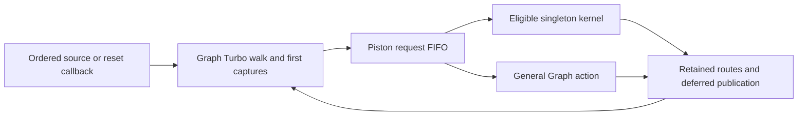

# BubbleSort and FPU: O5 runtime profile and final graph

For the current event/packed implementation, see the
[fresh ETW profile](CPU_FPU_PACKED_KERNEL_PROFILE.md). The singleton kernels and
timings below belong to the older frozen implementation.

Measured 2026-10-19. The next runtime pass should compile wire capture descriptors.
The larger algorithmic target is signal-arrival certification that lets connected
Instant kernels own wires. Both workloads still spend most inference samples in
Turbo propagation. Installed kernels are all singletons and own **zero wires**.

These results describe a frozen snapshot: `7aba05d` plus the separate
`compile-wire-shapes` pass and its supporting changes. The shared main checkout
continued changing during this work. This is not a measurement of those later
uncommitted changes. [Source, executable/PDB hashes and toolchain](../../../target/profiles/final-inference-20261019/provenance.json),
[tracked source patch](../../../target/profiles/final-inference-20261019/snapshot.diff)
and [new source files](../../../target/profiles/final-inference-20261019/new-files/)
preserve the measured snapshot.

## Measured BubbleSort gain

Production release executables differ only in whether `compile-wire-shapes` is
selected at O5. Both use stable Instant inputs, budget 8, `classic_redstone=false`,
logical CPU 4 affinity, and the unchanged 10,036-tick frozen sort episode.

| Clean pair | Pass disabled | Pass enabled | Throughput ratio |
| --- | ---: | ---: | ---: |
| 1 | 66.814786 s | 55.312746 s | 1.208x |
| 2 | 66.924560 s | 59.728019 s | 1.120x |
| 4, replacement | 69.595031 s | 57.690753 s | 1.206x |
| Median | **66.924560 s** | **57.690753 s** | **1.160x** |

That is **13.80% less inference time**, or 149.96 to 173.96 active game ticks/s.
The pass takes approximately 0.05 seconds to compile. Loading, compilation,
activation, per-tick publication, RAM observation, reset and continuation are
outside the inference timer.

Original pair 3 is retained in the raw data. Its enabled run overlapped an
external Cargo/rustc build in 15 process observations; both sides of that pair
are excluded from the clean comparison. The replacement has 84 two-second
observations with no competing compiler/test/benchmark process. The first two
pairs also have no such observed interference. This is process sampling, not a
guarantee that the host was otherwise idle.

All eight paired episodes match the frozen RAM trace at every tick, sort to
`0..15`, and have identical active/reset/32-native-tick-continuation checkpoints
and RAM digests. All have the same execution counts:

| Full-sort work | Count |
| --- | ---: |
| Callbacks | 205,197,749 |
| General wire walks | 3,882,011 |
| Piston samples | 35,541,685 |
| Accepted piston actions | 3,295,083 |
| Scheduled component ticks | 2,344,242 |
| Executed Instant kernels | 524,910 |

The pass makes existing work cheaper; it does not remove propagation. The
single default-O5 control remains insufficient to establish an Instant-only
speedup. These results are separate from the CHUNGUS gains.

[Raw paired reports and observations](../../../target/instant-wire-shapes-perf/),
[checked result summary](../../../target/profiles/final-inference-20261019/results-summary.json).

## Fresh runtime samples

The profiler uses release optimization, fat LTO and matching PDBs. It samples
the primary thread of its own debugger-launched child, with the normal heap
(`CDB -hd`), logical CPU 4 affinity and jittered sampling intervals. Microsoft
documents the [normal-heap option](https://learn.microsoft.com/en-us/windows-hardware/drivers/debugger/cdb-command-line-options)
and [debugger prompt commands](https://learn.microsoft.com/en-us/windows-hardware/drivers/debuggercmds/-pcmd--set-prompt-command-).
The diagnostic-heap attempt was aborted during compilation and excluded.

This is **debugger wall-clock stack sampling**, not ETW CPU interrupts or cache
counter measurement. Pauses and symbol processing affect elapsed time, so
debugger timers are never used for throughput claims. Inlined tick boundaries
are identified using their frozen source call sites as well as Graph methods.
The parser checks sample accounting and each exclusive partition's totals.

BubbleSort contributes 1,548 inference samples from a complete sort. FPU
contributes 1,395 inference samples pooled from the 16- and 64-vector captures:
four fresh O5 Graph replays, 24,832 Graph game ticks in total. Both use the same
fixed-seed raw operand/opcode generator, eight warm vectors, and OFF64/ON64
held phases. Native validation, compilation and publication are separate cuts.
No competing compiler/test/benchmark process was observed during these captures.
No input-update sample was resolved; that does not establish zero input cost.

The following rows are **inclusive and overlap**. Percentages are approximate
shares of the identified inference samples, not independently additive costs.

| Runtime path | BubbleSort | FPU raw-input diagnostic |
| --- | ---: | ---: |
| Turbo propagation | **68.0%** | **60.7%** |
| Neighbor identification | 38.2% | 30.0% |
| Neighbor capture | 31.3% | 23.8% |
| Guard evaluation | 17.6% | 18.6% |
| Power queries | 16.5% | 17.4% |
| Piston sampling | 14.3% | 15.3% |
| Kernel execution, including its callbacks | 17.6% | 20.7% |
| Retained kernel route delivery | 17.5% | 15.8% |
| Raw wire-side calculation | **3.9%** | **2.5%** |
| Scheduler helpers | 0.6% | 1.3% |
| Runtime allocator | 0.9% | 1.1% |

An exclusive partition of the Turbo subtree assigns **38.7% / 30.5% of all
inference samples** to neighborhood discovery/capture, **16.5% / 17.1%** to
walk/queue bookkeeping, and **4.9% / 5.9%** to callback admission. The remaining
Turbo samples are receiver callbacks. These partition rows sum to the Turbo
total, rather than to all inference time.

The hottest individual owners are `observe_site`, `guard_matches_using`,
`identify_wire_neighbors`, `deliver_route_inner` and `WireWalk::slot`.
`observe_site` alone owns about 12.4% of CPU samples and 6.9% of FPU samples.

Kernel time is largely retained propagation: **16.6% / 13.4%** of all inference
samples are simultaneously inside a kernel route and a Turbo walk. This is why
executing more singleton kernels has not removed the dominant cost. FPU Boolean
program evaluation accounts for about 3.6% inclusive, much less than propagation.

[CPU hotspots](../../../target/profiles/final-inference-20261019/bubblesort-normal/hotspots.json),
[FPU hotspots](../../../target/profiles/final-inference-20261019/fpu-pooled/hotspots.json),
[folded CPU stacks](../../../target/profiles/final-inference-20261019/bubblesort-normal/inference.folded),
[folded FPU stacks](../../../target/profiles/final-inference-20261019/fpu-pooled/inference.folded).

## What the final graph actually executes

The census uses the production O5 pipeline, then inspects its lowered program.
These are final IR counts, not estimates from schematic block counts.

| Final graph / executable | BubbleSort | FPU |
| --- | ---: | ---: |
| IR nodes, including contacts | 129,379 | 70,458 |
| Wires | 41,354 | 25,060 |
| Pistons | 16,561 | 8,100 |
| Query sites | 522,011 | 330,719 |
| Constant query sites | 421,656 | 273,378 |
| Guards | 484,945 | 236,977 |
| Original route delivery rows | 1,162,416 | 668,676 |
| Boundary ports | 2,718,924 | 1,362,796 |
| Recognized cells / corridors | 11,025 / 4,823 | 5,426 / 2,775 |
| Symbolic layer regions | 2,242 | 2,373 |
| Installed kernels / actors | 2,197 / 2,197 | 2,360 / 2,360 |
| Multi-actor kernels | **0** | **0** |
| Wires owned by installed kernels | **0** | **0** |
| Compiled wire-hop roots | 41,354 | 25,060 |
| Dust paths / private reset transfers | 0 / 0 | 0 / 0 |
| Proven fixed raw wire shapes | 29,683 | 20,549 |
| Proven fixed horizontal output directions | 115,420 / 165,416 | 82,678 / 100,240 |
| Reduced Boolean expressions in installed kernels | 439,603 | 485,453 |

Compiled hops cover every wire but retain the ordered walks and captures.
Recognition, symbolic composition and executable contraction are different
coverage measures. A large catalog does not mean the machine has become a
direct Boolean evaluator. Constant-site counts also do not measure runtime
capture frequency.



The active census covers the first 1,000 CPU ticks and the 3,136-tick FPU
16-vector replay, including warmup. Sample/action sums and kernel outcome sums
are asserted. FPU census counts exactly equal both corresponding production
profile replays; test-build elapsed time is not used as a performance result.

| Actors' current admission category | CPU accepted actions | FPU accepted actions |
| --- | ---: | ---: |
| Signal-arrival proof missing | **177,257 (53.1%)** | **265,798 (48.5%)** |
| Actors with installed kernels, including their ordinary lifecycle actions | 95,186 (28.5%) | 166,842 (30.4%) |
| Unsupported boundary effects, all reset families | 56,696 (17.0%) | 101,178 (18.4%) |
| Proof budget exceeded | 0 | **3,988 (0.73%)** |
| Symbolic only | 2,928 (0.88%) | 4,430 (0.81%) |
| Unadmitted | 1,832 (0.55%) | 6,304 (1.15%) |

These are action weights, not CPU-time weights. Approximately 99.7% of CPU
attempts with an installed kernel execute it: 53,017 successes versus 177
route/queue vetoes. FPU has 90,757 successes versus 348 route/predicate vetoes.
Broadening runtime eligibility checks has little remaining reach in these
histories; missing compile-time coverage is the larger issue.

Useful first proof targets are the CPU's 28-cell/one-corridor group, with 8,937
accepted actions, and its 60-cell/44-corridor group, with 6,833. Their witnesses
are `RequestSample` power-arrival cuts at actors 11357 and 8688. The FPU's hottest
declined group has 19 cells/three corridors and 5,362 actions, with a strong-power
request-sample witness at actor 3650. The JSON retains original site/link/route
references and actor positions. Existing outside consumers must remain boundary
effects; a settled electrical value alone cannot establish delivered updates.

[CPU final graph and active actors](../../../target/profiles/final-inference-20261019/graphs/final-graph-cpu_bubblesort.json),
[FPU final graph and active actors](../../../target/profiles/final-inference-20261019/graphs/final-graph-fpu.json).

## Recommended next work

1. **Separate `compile-wire-captures` pass.** Compile per-site capture operations
   for immutable constants, fixed component classes and supported contact
   selectors. Reuse existing shape/property proofs and canonical neighbor IDs.
   Capture live wire/gate properties at the original first-discovery cut. Keep
   every site's alias identity, visited/layer/heading bookkeeping, callback
   multiplicity, nested-walk isolation and unknown-selector fallback. Do not
   replace a captured value with a later live read. This directly targets the
   largest measured common cost; merely tuning raw shape arithmetic has much
   less remaining reach. Validate unchanged work counts and full-sort/native
   parity, then compare unprofiled release pairs.
2. **Separate arrival-certification extension for connected regions.** Start
   with the active groups above. Prove the actual ordered request/capture and
   reset obligations, retain outside consumers, and attach a typed certificate
   to the existing layer/kernel builder. Success must include owned interior
   wires and fewer general walks, alongside complete-sort and interruption/
   handoff checks. Increasing the kernel-invocation counter alone is insufficient.
3. **Reduce FPU compilation allocation.** About 62.5% of sampled compilation is
   Instant layer construction; `LayerBuilder::combine` is inclusive in 32.8%.
   It allocates temporary operand collections and clones child expressions just
   to inspect their variant. Borrow those variants and try the common unary/
   binary case before constructing a hash set. Preserve interning semantics,
   cancellation, budgets and complete-region fallback. This is a construction
   cost improvement, not an inference-speed claim.
4. **Establish an active FPU result protocol.** Verify changing result outputs
   and the native handoff before publishing useful FPU operations/s. Keep the
   current raw-mask experiment labeled as a diagnostic.

Do not start by raising the FPU proof budget: the 35- and 15-cell declined
regions together account for only 0.73% of observed actions and have no catalog
corridors. Nor does this profile support starting with SIMD, scheduler redesign
or runtime allocation tuning. Halving discovery/capture alone would imply about
1.24x CPU or 1.18x FPU throughput if other costs stayed fixed; those are scenario
calculations, not measured gains. Larger gains require eliminating propagation.

Relevant measured source: [capture and neighbor discovery](../../../target/profiles/final-inference-20261019/checkout/crates/core/src/redpiler/backend/graph/wire.rs),
[site/property selection](../../../target/profiles/final-inference-20261019/checkout/crates/core/src/redpiler/backend/graph/sites.rs),
[retained kernel routes](../../../target/profiles/final-inference-20261019/checkout/crates/core/src/redpiler/backend/graph/instant_kernel.rs),
[Boolean construction](../../../target/profiles/final-inference-20261019/checkout/crates/core/src/redpiler/analysis/instant/layers.rs).

## Correctness limits and reproduction

The FPU workload holds 35 raw lever bits through OFF64/ON64 phases, checking
native outputs every measured tick in a validation replay and phase boundaries
in a separate replay. Both 16- and 64-vector experiments report **only `0xffff`
at the sixteen existing output repeaters**, also in native execution. Internal
activity is substantial, but an active numerical result has not been established.

Final blocks, block entities, ordinary scheduled ticks, chat and lamp counts
agree with native in all four FPU Graph replays; the block difference lists are
empty. The serialized piston-state digest differs. It includes identity and
movement bookkeeping, and this experiment has not isolated the differing
fields or established continuation equivalence for these longer histories.
Do not call these full-state or floating-point correctness passes. The earlier
three selected FPU histories remain a separate bounded native/handoff check.

The wire-shape implementation snapshot previously passed 529 Redpiler tests,
two independent wire-geometry tests, workspace checking, 100 active CPU native
tick pairs plus handoff, and the three FPU native histories. This profiling
batch additionally runs the ignored final-graph census and the checks described
above; it does not rerun the whole suite against concurrent main-tree edits.

Artifacts and runnable scripts live under
`target/profiles/final-inference-20261019`. `sample_cdb.py` includes process
ownership checks and normal-exit accounting. `analyze_cdb.py` checks parsing and
partitions; `summarize_results.py` checks counters, RAM, endpoints and observed
interference. After recreating the frozen binaries and captures, run:

```powershell
py target/profiles/final-inference-20261019/analyze_cdb.py bubblesort-normal fpu-pooled=fpu-normal,fpu-64-normal
py target/profiles/final-inference-20261019/summarize_results.py
```

The per-capture `capture.json` files contain exact commands, intervals, exit
codes, sample times and process observations. The source patch, copied new
files, build JSON and executable/PDB hashes make the source and workload cuts
reviewable. Raw debug-heap and short-pilot attempts are retained separately.
