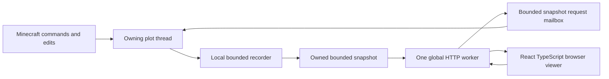

# Interpreter waveform analyzer design

Status: Rust recorder, public HTTP/SSE API and React viewer integration implemented; deployment remains opt-in. See the [implementation plan](WAVEFORM_ANALYZER_PLAN.md) detailed [viewer specification](VAPORVIEW_VIEWER_SPEC.md), and authoritative [API and command specification](WAVEFORM_API_SPEC.md).

## Scope and decisions

Add named block/component probes, record binary transitions in the interpreter, and inspect
captures in an independent React + TypeScript browser viewer styled after the
supplied VaporView screenshots. Each plot owns its recorder. One additional
global worker serves the read-only HTTP API for all loaded plots. Production
serves static frontend assets and privately routed API requests at one origin.

Signals are **On when output/power is greater than zero; Off when it is zero**.
Components report powered/output state; ordinary blocks report incoming power.
Strength changes such as 15 to 7 produce no transition. Missing blocks are unavailable,
shown as `X`, rather than silently reported as Off. This is validity metadata,
not an analog measurement feature.

The first integrated release includes command completion/help, plot edit
authorization for recording commands, configurable rank-based recording caps,
bounded memory, ordered transitions within ticks, public event retrieval
and a browser plot selector. Recording does not depend on an open browser.
VCD download is included and separate from the live viewer transport.

Defer the Three.js map, compiled Redpiler capture, bus decoding, trigger expressions,
permanent capture storage and browser controls that modify Minecraft. The future
map can reuse public plot identity and probe coordinates; it does not justify
world mesh streaming in this release.

## Existing implementation and integration points

| Existing code | Consequence for this feature |
| --- | --- |
| [Plot and PlotWorld](../../crates/core/src/plot/mod.rs) | Live storage and simulation belong to the plot thread. `Plot::tick` selects interpreter or Redpiler. |
| `PlotWorld::set_block_raw` | Shared successful block-write boundary; observe watched dust changes here, including player and WorldEdit writes. |
| `prepare_operation` / `advance_operation` | All game, nano and pico stepping shares ordered interpreter phases. Tick start and completion must be observed here. |
| [Tick history](../../crates/core/src/plot/history.rs) | Compressed full-world rewind snapshots; copy its budgeting discipline, not its recording representation. |
| [Snapshot restore](../../crates/core/src/plot/history/codec.rs) and [Git restore](../../crates/core/src/plot/git/mod.rs) | Replace chunks directly, bypassing ordinary writes; create explicit capture discontinuities after successful restore. |
| [Plot commands](../../crates/core/src/plot/commands.rs) | Dispatch, permission checks, `changes_plot`, completion nodes and command tests all need updates. |
| [Player permissions](../../crates/core/src/player.rs) | Reuse `can_edit_plot(owner, coords)` for owner/member/admin and standalone/dedicated behavior. |
| [Neighbor snapshots](../../crates/core/src/plot/neighbors.rs) | Existing model for generation-tagged live registration and bounded requests answered by the owning plot. |
| [Server lifecycle](../../crates/core/src/server.rs) | Start/stop the global API worker and remove stale plot registrations. |
| [Config](../../crates/core/src/config.rs) and [Docker Compose](../../docker-compose-prod.yml) | Add validated limits and private networking; preserve existing defaults and Minecraft port. |

Client block packets, render flushes and neighbor snapshots coalesce changes and
are unsuitable as the trace source. Do not serialize JSON, write files, perform
network I/O or wait for the API worker inside an electrical callback.

## Commands and authorization

The [API specification](WAVEFORM_API_SPEC.md) owns exact commands, permission nodes,
limit grants and lifecycle responses. Match the existing history control family:

| Command | Behavior |
| --- | --- |
| `/waveform [status]` | Show enabled state, selected window, caps and budget usage. |
| `/waveform on [ticks]` | Admit and start a fresh capture, including command-block events; zero dust probes are allowed. |
| `/waveform off` | Disable capture, discard retained signals/text events and release their memory. Keep named probe definitions for the next on. |
| `/waveform add <name> [x y z]` | Register a pointed non-air block or an absolute block position in this plot. Adding while off does not enable recording. |
| `/waveform remove <name>` | Remove a probe definition. |
| `/waveform list` | Show probe names, IDs, coordinates and current values. |
| `/waveform clear` | Clear history/events while keeping watches, buffer allowance and recording state. |
| `/waveform reset` | Show a warning; change nothing. |
| `/waveform reset confirm` | Stop recording and remove all watches and history/events. |
| `/waveform web` | Return the public viewer URL for this plot; no credential is issued. |

Each action has its own permission as well as the existing command-access and
`can_edit_plot` gates. Browser reads are public and require neither command
permission nor membership. Do not introduce a second membership model. Explain
that off/clear/reset/new on discard data in command help and success messages, following
`/rhistory` buffer semantics; failed admission preserves existing capture.

B means `Rank::Builder` / group `builder`, whose existing displayed prefix is B.
Builder's configurable maximum is **16 signals and 100 ticks**; every other rank's
maximum is **1,024 signals and 10,000 ticks**. Numeric permission/config policy
sets default/B to 16/100, Z to 64/1000, E/I to 1024/1000, and M/A to
1024/10000, independently of action grants. A maximum is not permission to
start a recorder, nor a guarantee of retention after a byte/event budget overflow.
For shared plots, use the activating actor's admitted limits and the API spec's
rules for collaborators, permission changes and reactivation.

Reuse the existing WorldEdit ray trace, bounded to 10 blocks and the current plot.
Explicit block coordinates remain Minecraft x/y/z. Public plot coordinates are
x/y plot indices, with API y mapping to the backend's plot z. Validate plot bounds,
height, negative coordinates and deployment-specific `PLOT_SCALE` before access.
Require dust at add time, a unique position and a case-sensitive unique name
matching `[A-Za-z_][A-Za-z0-9_]{0,31}`; reject duplicate registration.

While enabled, a changed probe set creates a new capture so one capture has an
immutable schema. Validate authorization, target and memory admission before
replacing existing data. While disabled, changes edit definitions only. Positions
are fixed when pistons move blocks; missing dust emits X and restored dust emits
its actual binary value.

## Command-block text events

Record successful command-block chat output at the owning plot's accepted enqueue
boundary, alongside signal changes with the same tick/sequence order. Do not record
ordinary player chat, failed command attempts or one copy per recipient. Preserve
what was printed as plain text, flattening accepted text components and removing
formatting without evaluating text as HTML. Pass source block position through the
existing world command hook so events remain attributable; update all callers and
test implementations even though compiled recording remains deferred.

An event at tick 100 appears as a dot on the shared ruler, with a preview of its
printed message. The event lane expands into one shared row of messages aligned
with their ticks; source positions remain available in tooltips. Expansion is presentation of output events, not expansion or
execution of command syntax. Events work with zero dust probes while recording is
on. They share tick retention and separate bounded count/text-byte quotas; recorder
overflow must never prevent Minecraft from executing or delivering chat output.
The detailed wire records, flattening rules and overflow behavior live in the
[API specification](WAVEFORM_API_SPEC.md). These captures are publicly viewable,
including any captured command-block output addressed to an individual player.

## Time and capture semantics

The authoritative timestamp is `(capture_id, tick, seq, phase)`:

- `capture_id` changes on reset, resume, probe-set changes, restore and plot reload.
- `tick` is the interpreter's logical game tick, not a redstone tick or wall time.
- `seq` is a capture-local increasing event order, including tick boundary records.
- `phase` identifies between-tick edits, scheduled work, piston events or movement.

Emit an initial value for every probe. Observe every successful watched block write
and append only changes in its normalized value. Preserve an On/Off/On pulse
inside one tick and the order of nested synchronous callbacks. The sequence means
execution order; it does not claim physical elapsed time inside a tick. A waveform
cannot locate a transition more precisely than the observation boundary provides.

Tick boundary hooks belong in the shared interpreter dispatcher, including empty
ticks and completion of partially stepped ticks. `/adv`, `/adv ... nt` and
`/adv ... pt` must produce the same trace as equivalent unpaused execution.
Do not hook only `Plot::tick`, since nano/pico advancement bypasses it. Retain the
existing `/rhistory` prohibition on partial stepping when history is enabled.

Between-tick player edits use the last completed logical tick with
`phase=between_ticks` and a later sequence. The API distinguishes the latest
observed tick from the last completed tick. Partial ticks remain identifiable;
the viewer never treats their current state as a completed tick sample.

One thousand ticks means a simulation window: nominally 50 seconds at 20 game
ticks/second, but only 10 milliseconds at 100,000 ticks/second. Pausing simulation
does not age the buffer by wall time. The browser can miss an entire window at
high TPS; it must report expiration rather than imply continuous acquisition.

### Retention and overload

Use a bounded deque of compact transition records plus tick boundary indexes and
a baseline array bounded by the admitted signal cap (up to 1,024 values). Evict complete old ticks when they
fall outside the configured window. Before removing transitions, advance the
baseline to the value immediately before the new left edge. Quiet signals must
remain reconstructible even when their last transition was evicted.

Bound bytes and transition count as well as ticks. A clock or feedback loop can
produce arbitrarily many writes in a single tick, and repeated edits can happen
while TPS is zero. If the current retained window reaches its byte/event ceiling,
stop capture with `overflow` and preserve a valid prefix. Do not drop individual
edges, block the interpreter, or mislabel a truncated tick as complete. Reserve
space for the final status before accepting records. Notify in-game editors and
show the reason in the API and viewer. `/waveform on` begins a fresh capture.

The [API specification](WAVEFORM_API_SPEC.md) owns concrete configuration and
admission limits. Builder defaults to 16 signals/100 ticks; other ranks to
1,024 signals/10,000 ticks. Keep independent per-plot/global recording and API work
budgets, signal-transition counts, text-event counts and text-byte limits. Choose
memory defaults from the 1,024-signal/10,000-tick benchmark rather than retaining
the earlier 64-signal-only estimates.

Tick indexes, capacities, baselines, text and allocator-backed buffers count against
budgets; JSON payload size is not the allocation size. Reserve before activation,
reject when the global budget is exhausted, and release on off/reset confirm/unload. A
viewer cannot consume recording reservations. An exhausted API work pool returns a
retryable error. Bound active requests, registered sources and responses. Invalid,
zero or overflowing configuration fails at startup with an actionable message.

## Thread ownership and API

Use one named OS thread with a current-thread async runtime for the global API,
not one server per plot or a new runtime for every request. Tokio is already a
direct dependency; Hyper 0.14 supplies HTTP/1 serving on that dedicated runtime. Keep serialization bounded so one client cannot monopolize the worker.

Register a bounded live-source mailbox on plot activation. Requests carry the
source generation, range/cursor and an owned reply channel.
The plot processes a limited number during its normal update loop and copies a
bounded consistent view of its recorder. Public reads do not check membership. Never send
`PlotWorld` references across threads. Reuse the neighbor-source registration
pattern, not its disk fallback: waveform captures are memory-only.

The HTTP task awaits replies asynchronously with a two-second timeout. A full
mailbox returns 503; excess clients receive 429. Expired requests are discarded
before snapshot allocation. A slow reader has an output byte limit and timeout;
it cannot retain the recording budget. Unregister by matching generation so an
old worker cannot remove a newly loaded plot's route. A browser request neither
loads an absent plot nor keeps a plot alive.

### Public API and plot selection

The [API specification](WAVEFORM_API_SPEC.md) is authoritative for endpoint names,
compact tuple layouts, baseline snapshots, delta cursors, text-event payloads,
status codes and reconnect semantics. Reads are public. There are no bearer tokens,
UUID checks, login requirements or editor-membership checks on HTTP reads. Only
Minecraft recording/configuration commands require permissions and plot edit access.

Every request identifies exactly one plot by public x/y plot indices; API y maps
to internal z. The browser keeps one active plot, aborts old requests on selection
change and never combines captures. Plots must already be loaded. Requests must
not load saves, pin a plot, keep its simulation running or serve stale captures
as loaded after unload. Source generations prevent reload/coordinate reuse races.

Send the signal dictionary and baseline in a paginated HTTP snapshot, then SSE
batches every **250 ms** with resumable cursors and 15-second heartbeats. Keep
bounded incremental batches
of ordered signal changes and command-block text events. Avoid repeating names,
positions, tick strings and object keys for every transition. Use ordinary JSON
with compression rather than a custom binary protocol; rate/byte/work limits
and cursor expiration must be explicit. Quiet unchanged data should be cheap.
Keep tick/sequence identities exact, and preserve same-tick signal/text ordering.

Serve frontend and API at one HTTPS origin through the proxy. The internal Rust
listener need not be exposed directly. Public reads still have validation, bounded
response sizes, rate control and timeouts. Render event messages as literal text,
never formatted HTML. Shared static assets and public data need no per-user IDE
or private workspace. A downloaded public capture cannot be revoked.

## Standalone viewer

The implementation is under `waveform-viewer/`: Vite + React + TypeScript,
canvas `Waveform.tsx`, React `Netlist`, `Toolbar` and `ContextMenu`, pure `trace.ts`
math and `state.ts` presentation state. The viewer supports the public API and an
explicit mock mode. This does not claim pixel-exact screenshot conformance. The former Docker/code-server prototype was stopped and deleted.
The [viewer specification](VAPORVIEW_VIEWER_SPEC.md) defines detailed layout,
menus, accessibility, interactions and acceptance checks.

Keep a single netlist at left, a simple plot X/Y topbar and a large coordinated
name/value/waveform area at right. The top ruler and A/B delta use Minecraft game
ticks, independent of TPS or wall time. Reorder and enable/disable signals locally;
removing a displayed row never deletes a watch. Groups and separators organize
rows; binary dust probes have no analog strength axis or fabricated buses.
Same-tick events remain sequence-ordered and inspectable without invented
physical sub-tick timing. Browser layout is saved locally per plot; capture data
remains memory-only. Probe definitions are saved in the plot metadata database
and restored with recording off. No binary world-save migration is needed.

Recreate the upstream scrolling mechanics verified in the specification: ordinary
mouse wheel over the graph pans time horizontally; Shift+wheel scrolls rows;
touchpad uses deltaX for time and deltaY for rows; Ctrl+wheel/pinch zooms around
the pointer (Mac Meta also accepted). Nonzero deltaX routes both axes even in
Mouse mode. Shift has priority over Ctrl. Wheel over names/values scrolls rows.
Provide Mouse/Touchpad/Auto selection: Auto's 100 ms heuristic can misclassify
hardware. Preserve native gesture momentum without adding invented inertia.
Clamp viewport bounds and keep labels, values and waveforms synchronized.

Prototype ticks use JavaScript numbers and small synthetic ranges. Before API
integration, parse absolute decimal u64 ticks and sequences as BigInt, subtract a
BigInt retained-origin tick, then convert only bounded safe relative offsets for
canvas math. Keep absolute labels, tick entry, delta and event identities exact;
reject unsafe ranges rather than rounding them.

VCD download uses legal identifiers, one-bit wires, initial values and `x` for
unavailable probes. The default `$timescale 1 ms $end` maps each game tick to
50 milliseconds, or 20 game ticks per second, independently of accelerated
execution speed. Preserve sequence order for same-tick transitions at the same
VCD timestamp. Export all probes in the retained capture; presentation visibility
does not discard recorded data. The React viewer's live path still uses events.

The frontend is independently implemented from screenshots and cited behavioral
research; GPL/AGPL upstream source has not been incorporated. This describes
implementation provenance, not a legal conclusion or a claim of complete
VaporView compatibility. No companion extension, extension host, WCP or Surfer
protocol belongs in this architecture.

## Simulation lifecycle

| Event | Required result |
| --- | --- |
| No probes / disabled feature | No allocation or API work; one cheap disabled check at observation hooks. |
| Recording on a loaded plot | Skip the interpreter idle shortcut while recording so quiet completed ticks age the rolling window. This can increase work for otherwise idle plots. |
| TPS zero | Capture authorized edits without inventing elapsed ticks. Byte/event bounds still apply. |
| Successful rewind or Git restore | Begin a new capture, resample probes and publish a discontinuity reason. Never append rewound ticks into the previous timeline. Failed restore leaves capture intact. |
| WorldEdit/player writes | Normal write observation, including transient changes. Direct bulk chunk replacement requires an explicit discontinuity. |
| Redpiler active or compiling | Reject starting recording. Do not infer internal compiled transitions from projected block writes. |
| Manual/automatic compile while recording | Reject manual compile and skip automatic compile with a clear reason until capture stops. Stopped captures remain readable. Resetting Redpiler permits a fresh interpreter capture. |
| Last player leaves | Stop recording with reason `empty_plot`; preserve the bounded capture for public reads until unload. Do not change plot lifetime. |
| Plot unload/server stop | Unregister source, release captures, stop/join global worker without blocking plot save. No save format change. |
| Worker bind failure | If enabled, fail startup clearly; never announce a working URL. API failure cannot corrupt simulation. |

## Acceptance

Once the backend and adapter ship, a plot editor can add two probes, advance a
known circuit and see real binary traces in the standalone viewer. The current
synthetic preview does not satisfy that integration gate. On/Off/On within one
tick remains inspectable in event order while ruler and delta use game ticks.
Unauthorized recording commands fail; public HTTP reads succeed only for loaded plots. Retention reconstructs quiet signals,
overflow is visible, rewind creates a new capture and slow browsers never block
simulation. Review visuals and actual mouse/touchpad input against the viewer
specification. Measure disabled and watched high-activity overhead against the
interpreter baseline before production enablement.
