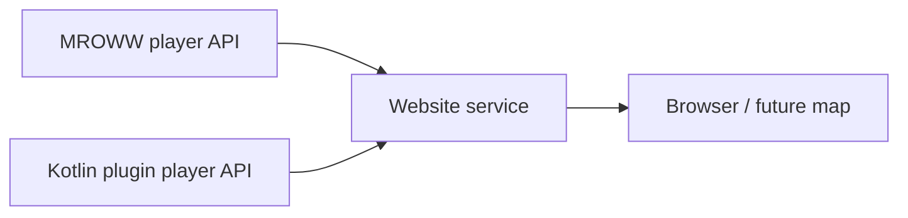

# MROWW public API

Status: waveform API implemented; player API proposed. This document describes
the HTTP contract shared by a frontend and a backend. The Rust implementation
is in [`crates/core/src/waveform/`](../../crates/core/src/waveform/); the React
adapter is in [`waveform-viewer/src/api.ts`](../../waveform-viewer/src/api.ts).
A different backend can implement the same contract without using MROWW's
internal types or threading model.

## Common rules

- API paths are versioned under `/api/v1`. Responses are JSON unless stated
  otherwise. Live responses use `Cache-Control: no-store` and may use gzip.
- Existing waveform reads are public and read-only. Minecraft commands control
  recording; the browser cannot change it. Read requests must not load or pin
  a plot, advance simulation, or reset its unload timer.
- API coordinates `{x}/{y}` are signed 32-bit **plot indices**. Plot `y` is the
  second horizontal coordinate, corresponding to Minecraft's block `z`.
  Block positions are absolute `[x, y, z]`, with vertical block `y`.
- Absolute ticks and sequence numbers are decimal strings, allowing exact u64
  values in JavaScript. A game tick represents 50 ms at the nominal 20 TPS.
- Fields added compatibly may be ignored by clients. A changed tuple layout or
  incompatible meaning requires a new version. Render names and text as text.
- Source/capture IDs and cursors are opaque. They are not credentials and must
  not be interpreted, fabricated or reused for a different plot or server.

## Waveform API — implemented

Only one plot is displayed at a time, although many readers can select different
plots. A loaded plot with no active capture returns a valid empty or disabled
state. An unloaded plot returns `404 plot_not_loaded`.

| GET endpoint | Result |
| --- | --- |
| `/api/v1/plots/{x}/{y}/waveform` | Metadata: state, watches, owner, limits, usage and time window. |
| `/api/v1/plots/{x}/{y}/waveform/data?limit=4096` | First capture page, including schema and baseline. |
| `/api/v1/plots/{x}/{y}/waveform/data?cursor={cursor}&limit=4096` | Continue a snapshot or read newer records. |
| `/api/v1/plots/{x}/{y}/waveform/stream?cursor={cursor}&limit=4096` | SSE batches after the initial snapshot is complete. |

Coordinates must be canonical decimal integers. `limit` is optional, defaults to
4,096 and ranges from 1 to 8,192 records; unknown or repeated query parameters
are rejected. For example, `/api/v1/plots/3/-2/waveform/data` reads plot `(3,-2)`.

### Data page

The example shows two probes, a command-block message and two signal changes.
`owner` is the cached plot owner name, `null` for an unclaimed plot, or
`"Unknown owner"` if the name is unavailable. No owner UUID is exposed.

```json
{
  "source": "a7",
  "capture": "c2",
  "owner": "Alice",
  "state": "recording",
  "reason": null,
  "window": {
    "first_tick": "80",
    "observed_tick": "100",
    "completed_tick": "99",
    "partial_tick": true
  },
  "snapshot": {
    "signals": [["clock", [770, 64, -510]], ["ready", [771, 64, -510]]],
    "baseline": [0, 1],
    "baseline_tick": "80",
    "baseline_seq": "400",
    "through_seq": "403"
  },
  "baseline_seq": "400",
  "seq_base": "400",
  "ticks": [["100", [[1, 0, 0, 1], [2, 1, 775, 64, -509, "[@] ready", 0], [3, 0, 1, 0]]]],
  "more": false,
  "cursor": "opaque-continuation"
}
```

- Signal IDs are zero-based indexes into `snapshot.signals`, whose entries are
  `[name, blockPosition]`. Baseline values are `0`, `1`, or `null` (unavailable).
- `snapshot` is present on the first page of an active capture. It fixes the
  baseline and a snapshot high-water mark (`through_seq`). Later pages can have
  `snapshot: null`; a tick's records may span pages.
- A tick group is `[absoluteTick, records]`. The first item of each record is
  a numeric offset added to the page's `seq_base`. Records are ordered by this
  capture-local sequence, including changes within the same tick.
- A signal record is `[seqOffset, 0, signalId, value]`.
- A command-output record is `[seqOffset, 1, blockX, blockY, blockZ, text,
  originalBytes]`. `originalBytes` is zero for complete text; otherwise it is
  the UTF-8 byte count before truncation.
- The top-level `baseline_seq` is the current last evicted sequence. The one
  inside `snapshot` belongs to the fixed initial baseline. `more` indicates
  remaining pages through the fixed high-water mark; after the final page the
  returned cursor switches to live tailing.

The metadata route also includes `signals`, `limits`, and `usage`. Possible
states are `recording`, `disabled`, `empty`, `stopped`, `overflow` and
`unsupported_backend`. With no capture, data has an empty `ticks` array and no
active capture/cursor; registered watches can still appear in `signals`.
Command output is plain text from accepted command-block chat emissions; player
chat is not recorded. Targeted command-block output is also publicly readable.

### Resume and SSE

1. Fetch `/data` and follow `cursor` while `more` is true. Apply each whole
   page before storing its cursor; ignore duplicate sequences.
2. Open `/stream` with the final cursor. A `batch` event contains the same page
   format and its SSE `id` is the new cursor. `Last-Event-ID` takes precedence
   over the query cursor on reconnect. Batches are checked every 250 ms; quiet
   streams receive a comment heartbeat every 15 seconds.
3. Close the old stream and ignore late responses when switching plots. On a
   `reset` event or an expired/changed capture, fetch a fresh snapshot. A reader
   that has consumed every evicted record may continue tailing across window
   rollover; `last_consumed_seq < baseline_seq` requires a resnapshot.

A `source` changes when a loaded plot instance is replaced. A `capture` changes
when a capture is restarted or its schema/history is reset. Never combine data
across either change. Pages and SSE are bounded; a stalled reader cannot stop
simulation or keep a plot loaded.

| HTTP status | Examples of `error` | Client action |
| --- | --- | --- |
| 400 | `invalid_coordinates`, `invalid_query`, `invalid_limit`, `invalid_cursor`, `snapshot_required` | Correct the request. |
| 404 | `plot_not_loaded`, `not_found` | Show unavailable; retry later or correct the path. |
| 409 | `source_changed`, `capture_changed`, `history_expired` | Fetch a fresh snapshot. |
| 429 | `rate_limited` | Retry after `Retry-After`. |
| 503 | `busy`, `source_timeout`, `response_too_large` | Keep last data marked stale and retry with backoff. |

An error is an object such as `{"error":"history_expired","resnapshot":true}`.
Errors before SSE headers use HTTP status codes; later stream failures send a
`reset` event and close the stream. Readers do not need Minecraft permissions.

### Recorder and commands

Watches are persistent plot definitions (name and block position); capture data,
command output and the enabled state are not persisted. A watched non-air block
reports its binary powered/lit state or incoming power; missing blocks are
`null`. The interpreter records ordered changes and command-block output, not a
full sample matrix. Compiled recording is unsupported. A bounded rolling window
keeps a baseline; overflow stops recording and keeps the valid retained prefix.

| Command | Behavior |
| --- | --- |
| `/waveform add <name> [x y z]` | Watch a pointed block or explicit block position. |
| `/waveform addbulk <name> <bits>` | Select blocks by left-click, low bit first; commit all probes together. |
| `/waveform cancel` | Cancel the caller's pending bulk selection. |
| `/waveform remove <name>` / `list` | Remove a watch / list watches and clickable block coordinates. |
| `/waveform on [ticks]` | Start a fresh capture. Default is 1,000 ticks, capped by the actor's allowance. |
| `/waveform off` | Stop and discard captured history; keep watches. |
| `/waveform clear` | Clear history/events; keep watches, capture window and recording state. |
| `/waveform reset` | Warn without changing anything. |
| `/waveform reset confirm` | Stop recording and remove all watches and history. |
| `/waveform status` / `web` | Show status / clickable public viewer URL for this plot. |

Recording actions have separate permissions, the waveform family permission,
command access and plot edit checks; `on` and `off` use the `enable` and
`disable` action permissions. `help` and `cancel` are handled separately.
Effective signal/tick allowances are capped by configured limits and the acting
player's permissions. The current deployment grants:

| Group | Signals | Ticks |
| --- | ---: | ---: |
| default / B | 16 | 100 |
| Z | 64 | 1,000 |
| E / I | 1,024 | 1,000 |
| M / A | 1,024 | 10,000 |

See [permissions](../../docs/MCHPRS_PERMISSIONS.md) for exact nodes and policy.
The backend defaults include 32 MiB per capture, 256 MiB global capture memory,
64 MiB work memory, 500,000 records, 10,000 text events, 4 MiB text per capture,
64 KiB per text event and 512 KiB per serialized page. These are configurable
where exposed in `Config.toml`; workload and retention can hit a byte/record limit
before the tick window fills. An explicit quota or memory failure must not erase
an existing capture.

The React viewer exports physical probes to VCD at 50 ms/tick. Command output is
a `command_output` string signal using a VCD extension; not every VCD reader
supports strings. Browser group/bus formats do not alter physical probe values.

## Players API — proposed, not implemented

The future world map combines players from exactly two independent backends:
MROWW and a Kotlin Minecraft plugin. Each backend serves its **own** player
snapshot. A separate website service reads both and serves the combined result
to browsers. MROWW never requests, stores or forwards the plugin's data, and
the plugin does not proxy MROWW.



Player data is independent of recording and works without a selected plot. The
existing waveform API continues to use MROWW directly through the website's
proxy. The Kotlin plugin only needs the player resource; it may implement the
waveform contract separately in the future. This is a proposal: neither player
endpoint, the Kotlin plugin API nor the website aggregation is implemented.

### Backend contract: `GET /api/v1/players`

Each backend returns a complete snapshot of the online players it exposes. The
website calls the same path on two independently configured internal addresses.
Proposed response from either backend:

```json
{
  "source": "server-instance-opaque",
  "players": [
    {
      "id": "550e8400-e29b-41d4-a716-446655440000",
      "name": "Alice",
      "world": "minecraft:overworld",
      "position": [770.5, 65.0, -509.5],
      "plot": [3, -2]
    }
  ]
}
```

- `source` is an opaque server-instance generation; it changes on restart or
  replacement. It is independent of a waveform plot's `source`.
- `id` is the player's canonical lowercase Minecraft UUID, stable across name
  changes. It identifies an account, not a connection or entity ID. Backends
  with offline-mode UUIDs expose the UUID they actually use.
- `name` is the current plain-text display name. `world` is a stable backend
  world/dimension identifier. `position` is finite absolute Minecraft block
  coordinates `[x, y, z]` as JSON numbers; `y` is height. Use `null` for
  unavailable `world` or `position`, never fabricated coordinates.
- `plot` is `[plotX, plotY]` when known, otherwise `null`. It is optional
  information: a backend without plots can return `null`. There are no waveform
  IDs, recorder permissions or rank assumptions in the player schema.
- `players: []` means a successful complete snapshot with nobody online. A
  disabled/unsupported endpoint returns 404; a temporarily unavailable source
  returns `503 {"error":"players_unavailable"}`. Never present a partial or
  stale list as a complete current list.

The backend obtains a bounded snapshot from its own authoritative player state,
with a timeout and response-size limit. Positions need not be captured at an
identical instant across players; return `null` when a position is not available
for a known online player. Reads must not scan or load plots, block simulation on
network writes, or let a slow client pin mutable player state. If a complete
bounded player list cannot be returned, return a retryable error.

### Website contract: `GET /api/v1/players`

While enabled, the website service polls MROWW and the Kotlin plugin independently
in the background at roughly one-second intervals, with at most one request in
flight per backend. Browser
requests read the latest results from the website service, not from MROWW. The
public endpoint groups players by backend so its response can represent a failed
backend without hiding healthy players or presenting a partial list as complete:

```json
{
  "backends": [
    {
      "id": "mroww",
      "status": "ok",
      "source": "mroww-instance-opaque",
      "players": [
        {
          "id": "550e8400-e29b-41d4-a716-446655440000",
          "name": "Alice",
          "world": "minecraft:overworld",
          "position": [770.5, 65.0, -509.5],
          "plot": [3, -2]
        }
      ]
    },
    {
      "id": "plugin",
      "status": "unavailable",
      "source": null,
      "players": null
    }
  ]
}
```

- Backend IDs `mroww` and `plugin` are stable website identifiers, independent
  of the backend-provided `source` generation. An `ok` result has a source and
  a complete list, which may be empty. A failed or timed-out backend has
  `status: "unavailable"`, `source: null`, and `players: null`; a backend that
  does not implement the resource has `status: "unsupported"` and nulls.
- Polls, timeouts and retries are independent. An unavailable backend never
  delays or hides the other backend's list. Bound response size, read time and
  concurrency; reject invalid upstream snapshots. Mark an old result unavailable
  when polling cannot refresh it, rather than presenting it as live.
- The browser identifies a displayed player by `(backend id, player UUID)`, so
  overlapping snapshots during a server transfer or differing offline-mode UUID
  policies do not silently merge positions. World IDs and plot coordinates are
  interpreted within their backend. Replacing a backend's `source` invalidates
  its previous snapshot. The UI can show the backend name for each player.
- The browser polls this single website endpoint while the map is visible, with
  one request in flight and backoff on failure; it stops when no longer needed.
  The website returns `Cache-Control: no-store`. Start with JSON snapshots; add
  SSE or deltas only if measurement shows they are needed.

The upstream `/api/v1/players` response is a single backend snapshot; the same
path on the website origin is the grouped response above. Configure backend
addresses privately in the website service, rather than exposing either backend
address to the browser. The existing Nginx-only viewer cannot poll or combine
data by itself, so this needs a small website API process, which may run in the
viewer container or as a separate Docker service. The current production proxy
routes the waveform plot API; exposing the website's players endpoint requires
a separate HTTPS proxy route. Any host Nginx change needs the user's permission.

This endpoint would expose online identities, presence and positions publicly.
Honor the server's existing visibility policy and do not expose addresses,
permissions, inventory, chat, authentication data or historical movement. A
backend must document its visibility behavior. Player data is not inserted into
waveform captures or VCD exports.

### Implementation plan and checks

1. Implement MROWW's own player snapshot on its existing API worker. Its global
   player list has names and plot indices; exact positions are owned by plot
   threads, so publish bounded position snapshots without sharing mutable player
   state or doing network I/O on simulation threads.
2. Implement the same snapshot endpoint in the Kotlin plugin. Read player state
   using the host server's supported scheduler; perform serialization and
   network I/O away from its simulation thread.
3. Add the website API process, configure both internal addresses, poll them
   independently, and serve the grouped website response. Keep the existing
   MROWW waveform proxy and 250 ms SSE behavior. Prepare Docker and proxy changes
   for review before any host Nginx change.
4. Add the future map's consumer for the grouped endpoint. Render only available
   positions and show each backend's status independently.
5. Test multiple players, empty lists, joins/leaves, transfers, movement, world
   changes, UUID stability, missing positions and source restarts. Test both
   backends online, either offline, unsupported responses, invalid/oversized
   snapshots, timeouts, recovery and the same UUID on both servers. Verify that
   neither backend calls the other, browser polling stops on view change, the
   website worker stops on shutdown, and reads or slow clients cannot block
   simulation.
